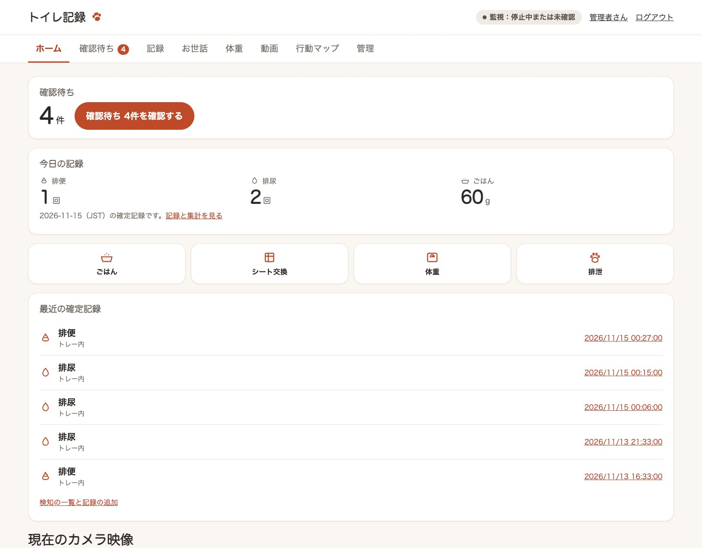

# poop-detector

[](https://github.com/ysakae/poop-detector/actions/workflows/ci.yml)

犬のトイレを RTSP カメラで見守り、排便・排尿の「可能性」をスマートフォンや Mac に通知するローカル監視ツールです。
空のトイレの画像と今の映像を比べ、変化が一定時間残ったときに知らせます。映像は手元のマシンで処理し、クラウドへは送りません（任意の動画の自動判定を除く）。



> **English summary:** poop-detector watches a dog's toilet tray through an RTSP camera and notifies you when a lasting change suggests the dog has pooped or peed. It compares frames with an empty-tray baseline on your own machine; it does not recognize feces or urine itself. The documentation is in Japanese.

## できること・できないこと

**できること**

- 空のトイレとの明るさ・色の差分から、排便・排尿の候補を検知して通知する
- 犬がトイレにいる間や、ROI の端から体が入り込んでいる間は判定を保留する
- 検知の前後の短い動画を保存し、ブラウザーでラベルや確定記録を付ける
- 排便・排尿の記録を日別・時間帯別に集計する

**できないこと**

- 便や尿そのものを識別すること。通知は「変化があった」という候補で、排泄の確定ではありません
- 犬がトイレを離れる前に通知すること。食糞を確実に防げる保証はありません
- 吸収されて見えない尿、既存の跡とほぼ同じ見え方の排泄など、映像に変化が出ない排泄を検知すること

実際の排泄の映像での精度（Precision・Recall）と通知の遅延は、まだ測定していません。

## 機能一覧

機能は成熟度で3つに分けています。

- **中核**：既定で動き、常に動作を確認している機能
- **任意**：設定かフラグで有効にする機能。前提となる準備があります
- **実験的**：分析や判定の方法を試している段階の機能。結果の精度は確かめておらず、今後変わったり外れたりすることがあります

| 区分 | 機能 | 有効にする方法 | 前提と制限 | 説明 |
|---|---|---|---|---|
| 中核 | 差分による排泄候補の検知 | `run` | 空のトイレの基準画像と監視範囲の登録が必要。排泄物そのものは識別しない | [判定の仕組み](docs/detection.md) |
| 中核 | macOS 通知・ntfy 通知 | 既定（`.env` で ntfy に切り替え） | macOS 以外では ntfy の設定が必要 | [通知](docs/notifications.md) |
| 中核 | ラベル付けと排泄の記録 | `label-gui` | 同じマシンのブラウザーで使う。起動ごとのトークン付き URL で開く | [記録とラベル付け](docs/records.md) |
| 中核 | 検知前後の動画の保存 | 既定で有効（`clips.enabled`） | FFmpeg の `libx264` が必要。常時録画はしない | [動画](docs/video.md) |
| 任意 | 多角形の監視範囲 | `setup-roi --polygon` | 登録には画面のあるマシンが必要 | [初期設定](docs/setup.md) |
| 任意 | トレー追従 | `features.track_tray`、`--track-tray` | トレーの縁が映っていること。縁が隠れている間は判定を保留する | [初期設定](docs/setup.md#カメラやトレーの小さなずれに追従する) |
| 任意 | 録画を待たない見守り通知 | `features.early_alert`、`--early-alert` | 滞在を知らせるだけで、排泄の判定ではない | [判定の仕組み](docs/detection.md#録画を待たずトイレの様子を知らせる) |
| 任意 | 動画の自動判定 | `features.video_review`、`--video-review` | 既定の判定器は Codex CLI で、ログインが必要。動画から切り出した画像を提供元に送る | [動画](docs/video.md#動画の自動判定と通知を使う) |
| 任意 | 犬の存在・出入りの検出 | `dog.enabled`、`--dog` | `setup-dog-model` でモデルを取得する。実映像での検出精度は確かめていない | [犬の検出](docs/dog.md) |
| 任意 | サークルの行動マップ | `features.activity_map`、`--activity-map` | 床面の登録と犬の検出が必要 | [犬の検出](docs/dog.md#サークルの行動マップ) |
| 実験的 | トレー外の排泄候補 | `features.detect_outside`、`--detect-outside` | 動画の自動判定と犬の検出が必要。精度は確かめていない | [犬の検出](docs/dog.md#トレー外の排泄候補を検知する) |
| 実験的 | 保存動画の旋回候補の分析 | `circling-review` | 保存済みの動画の分析だけで、監視や通知にはつながっていない | [犬の検出](docs/dog.md#保存動画から旋回候補を確認する) |

普段使う機能は `config/config.yaml` の `features` に書いておけば、起動は `poop-detector run` だけで済みます（[初期設定](docs/setup.md#使う機能を設定ファイルで有効にする)）。

## 必要なもの

- Python 3.11 以上と [uv](https://docs.astral.sh/uv/)
- FFmpeg（動画の保存に `libx264` を使います）
- RTSP で映像を配信できるカメラ。トイレ全体が映る位置に固定してください
- macOS または Linux（下の表を参照）
- 監視領域の登録には画面のあるマシンが必要です。画面のない Linux では、別のマシンで登録した `data/roi.json` をコピーして使います（[初期設定](docs/setup.md#画面のない環境で使う)）
- 画面と通知の文面は日本語のみです

| 環境 | 状況 |
|---|---|
| macOS（Apple Silicon） | 開発に使い、実際のカメラで動かしています |
| Linux（Ubuntu 24.04） | GitHub Actions でテスト一式と主要な機能の動作を確認しています。実際のカメラでは未確認です |
| Docker | GitHub Actions でイメージのビルドとコンテナ内の動作を確認しています。実際のカメラでは未確認です（[Docker / Linux](docs/docker.md)） |
| Windows | 非対応です。排他制御に `fcntl` を使っているため、起動時に案内を出して終了します。WSL2 などの Linux 環境での実行は未確認です |

macOS 以外では macOS の通知センターを使えないため、通知には ntfy の設定が必要です（[通知](docs/notifications.md)）。

## クイックスタート

リポジトリのディレクトリで依存関係を入れ、設定のひな形を作ります。

```bash
uv sync --frozen
cp -n .env.example .env
cp -n config/config.example.yaml config/config.yaml
```

`.env` の `POOP_RTSP_URL` にカメラの RTSP URL を入力し、映像を取得できるか確認します。カメラ側の設定は [初期設定](docs/setup.md) を参照してください。

```bash
uv run poop-detector check-camera
```

トイレに犬や物がない状態で、監視領域（ROI）と空のトイレの基準画像を登録し、通知を試してから監視を始めます。ROI は表示された画面でトイレ全体を囲み、Enter で確定します。

```bash
uv run poop-detector setup-roi
uv run poop-detector capture-baseline
uv run poop-detector test-notification
uv run poop-detector run
```

通知や画面に犬の名前を出す場合は、`config/config.yaml` の `pet_name` に設定してください。

Ctrl+C で停止します。通知は、`.env` に `POOP_NTFY_TOPIC` があれば ntfy、なければ macOS の通知センターに届きます。

失敗の原因が表示だけで分からないときは、`uv run poop-detector --verbose run` のようにサブコマンドの前に `--verbose` を付けると、詳細なログとトレースバックが出ます。RTSP URL などの認証情報は伏せ字になりますが、不具合の報告に貼る前に内容を確かめてください。報告には `uv run poop-detector diagnose` の出力（バージョン、OS、有効な機能、登録の有無。URL・トピック名・保存先のパスは含まない）も添えてください。

### PyPI から入れる場合

0.1.0 を PyPI に公開した後は、リポジトリを取得せずに次のコマンドでも入れられます。

```bash
uv tool install poop-detector
```

コマンドは作業用のディレクトリで実行してください。そのディレクトリの `.env`、`config/config.yaml`、`data/` を使います。ひな形はリポジトリの [`.env.example`](.env.example) と [`config/config.example.yaml`](config/config.example.yaml) を参考にしてください。

## 記録とラベル付け

監視とは別のターミナルでラベル GUI を起動すると、起動ごとに変わるトークン付きの URL（`http://127.0.0.1:8765/?token=...`）がブラウザーで開きます。トークンを持たないブラウザーやプログラムは画面や映像を閲覧できません。

```bash
uv run poop-detector label-gui
```

通知された画像や動画に「排便」「排尿」「誤検知」などのラベルを付け、目視で確認した排泄や見逃しを記録できます。記録は日別・時間帯別に集計でき、検知の精度の評価にも使います。詳しくは [記録とラベル付け](docs/records.md) を参照してください。

## データの保存先と外部への送信

- 基準画像、ROI、イベント画像、動画、SQLite のデータベースは、既定でリポジトリ直下の `data/` に保存します。室内の映像を含むので、取り扱いに注意してください
- RTSP URL には認証情報が含まれます。`.env` にだけ書き、Git にコミットしないでください。ルーターの RTSP ポートを外部に公開しないでください
- ntfy を使うと、通知の短い本文が ntfy のサーバー（既定は `ntfy.sh`）に送られます。映像やカメラの URL は送りません。無料トピックは名前を知っている人なら誰でも読めます
- `--video-review` を使うと、動画から切り出した画像が 選んだ判定器の提供元へ送られます
- `setup-dog-model` は犬検出モデルを GitHub から取得します。監視の開始時に自動で取得することはありません

`data/`、`.env`、`config/config.yaml` は Git の管理対象外です。詳しくは [データの保存先と外部への送信](docs/privacy.md) を、脆弱性の報告方法は [SECURITY.md](SECURITY.md) を参照してください。

## ドキュメント

- [初期設定](docs/setup.md) — カメラ、`.env`、監視領域、基準画像、トレー追従
- [判定の仕組み](docs/detection.md) — 差分検知、排尿の検知、見守り通知、設定項目、制限
- [記録とラベル付け](docs/records.md) — ラベル GUI、排泄の記録、評価指標
- [通知](docs/notifications.md) — macOS の通知と ntfy
- [動画](docs/video.md) — 動画の保存、容量の管理、動画の自動判定
- [犬の検出](docs/dog.md) — 犬の存在、トレー外の検知、行動マップ、旋回候補
- [Docker / Linux](docs/docker.md)
- [データ収集の方針](docs/data-collection.md)
- [データの保存先と外部への送信](docs/privacy.md)
- [設計の概要](docs/architecture.md) — 開発者向け

## ライセンス

[MIT License](LICENSE) です。犬検出モデル（OpenCV Zoo の YOLOX）はリポジトリに含めず、`setup-dog-model` で取得します。モデルは Apache License 2.0 で、取得時にモデルの `LICENSE` も一緒に保存します。依存ライブラリ、FFmpeg、Docker イメージのライセンスは [依存ライブラリと取得物のライセンス](docs/licenses.md) にまとめています。

## 開発

```bash
uv run pytest --cov
uv run ruff check .
uv run ruff format --check .
uv run mypy
```

テストは人工画像と一時ディレクトリを使い、実カメラや実データには依存しません。プルリクエストと `main` への push では、GitHub Actions が Ruff の検査と書式の確認、mypy の型チェック、パッケージのビルド、Ubuntu の Python 3.11・3.12 でのテストとカバレッジの下限の確認、Docker イメージの確認を行います。変更履歴は [CHANGELOG.md](CHANGELOG.md) にあります。Issue やプルリクエストを送る前に [コントリビューションの手引き](CONTRIBUTING.md) と [行動規範](CODE_OF_CONDUCT.md) を読んでください。
