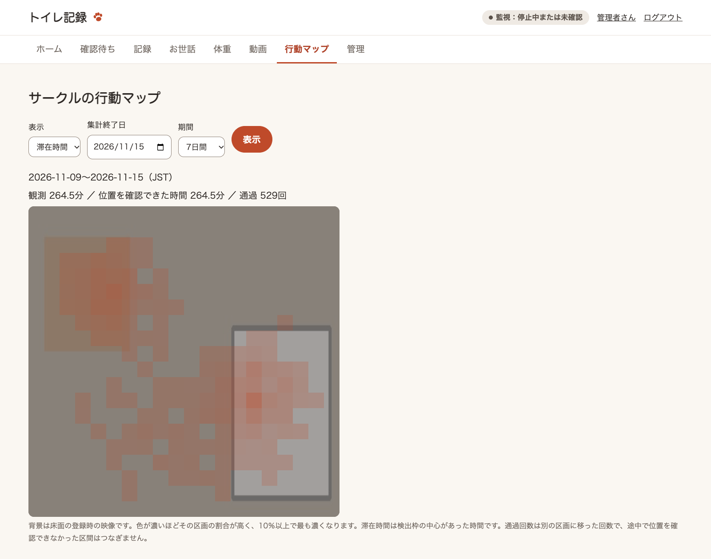
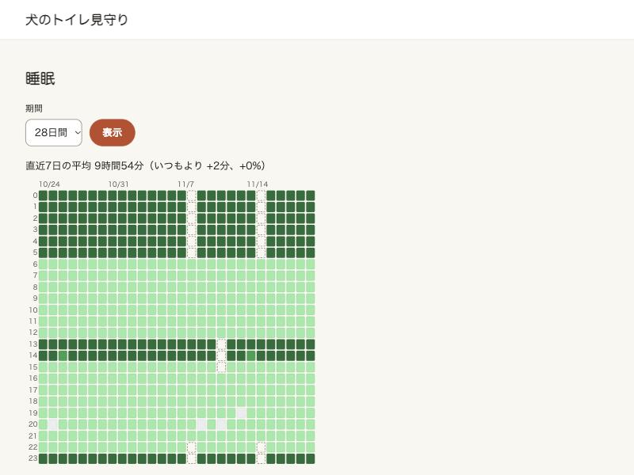

# 犬の検出

## 犬の存在・トイレへの出入りを検出する

OpenCV Zoo の YOLOX モデルを使い、犬の検出枠が ROI に重なる間は排泄の差分判定を保留します。
トイレへの入場・退場も短い動画の保存トリガーにするため、差分通知が出ない日常動作を集められます。
姿勢推定や排泄の認識ではありません。検出枠の重なりは保守的な判定で、犬の体が実際にトイレを隠しているとは限りません。

```bash
uv run poop-detector setup-dog-model
uv run poop-detector run --dog
```

モデルは初回に明示コマンドで取得します。固定版と SHA256 を確認し、`data/models/dog-yolox` に保存します。
監視開始時に自動ダウンロードしません。既存モデルが異なる場合は上書きせず停止します。
毎回 `--dog` を付ける代わりに、`config/config.yaml` の `dog.enabled: true` で有効にできます。

- 既定1秒1回の犬推論、2秒の見失い猶予を使います。`dog.fps` を下げるときは `dog.exit_seconds` を `2 / dog.fps` 以上にします。
- 入場と退場の保存には、それぞれ既定60秒のクールダウンを設定しています。
- 犬の推論エラー時は排泄判定を保留し、再試行します。
- 画像取得と動画バッファは別スレッドで継続します。動画を無効にした場合でも犬による遮蔽判定は使えます。

手元の静止画で検出枠と負荷を確認できます。画像パスは実際のファイルに置き換えてください。

```bash
uv run poop-detector check-dog --image /absolute/path/to/image.jpg --repeat 10
```

結果は `data/models/dog-yolox/check-dog.json` に保存し（画像の場所と検出枠は保存しません）、GUI の「管理 › 判定器とモデル」に、モデルのハッシュの確認結果と並べて出します。

カメラの設置位置を変える前の、犬が写った保存画像で検出を確認し、人工の無地画像では検出なしでした。
開発者の Apple Silicon の Mac で、反復推論は平均約73ms、プロセス RSS 約421MiB でした。CPU の表示値は休止なしの反復推論時の値です。
現在の俯瞰の設置位置での Precision/Recall と、RTSP の処理を含む総負荷は未確認です。カメラを固定し、実動画で見逃しと誤検出を確認してください。
モデルの比較・検証結果は [dog-model-validation.json](dog-model-validation.json) に記録しています。画像やモデル自体はリポジトリに含めません。

出典・モデルライセンス：[OpenCV Zoo YOLOX（Apache 2.0）](https://github.com/opencv/opencv_zoo/tree/48b10fa505aeb51fbd127fc60a5c660040e823b7/models/object_detection_yolox)。
重い追加の Python 依存は導入せず、既存の OpenCV DNN で CPU 実行します。

## トレー外の排泄候補を検知する

> **実験的な機能です。** 判定の方法を試している段階で、精度は確かめていません。今後、変わったり外れたりすることがあります。

既存のトレー範囲を登録した状態で、トレーと監視したい周囲の床を囲みます。
トレー外で犬が約2秒とどまると、その前後の動画を保存します。
犬がトレーに重なっている間と、トレーを離れてから10秒の間は数えません。トレーへの出入りの途中で立ち止まった場面は犬の入退場の動画に映るので、別に録らないためです。
犬が場所を少し変えるたびに新しい滞在として数えますが、前の動画と時間が重なる間は録画を先に延ばし、前の動画の直後から続きを1本だけ録ります。同じ場面の動画を何本も作らず、判定器を呼ぶ回数を抑えるためです。
動画の自動判定で新しい便、尿の流れ、または新しい濡れ跡を確認した場合に、トレー外の候補として通知します。`--video-review` が必要です。

```bash
uv run poop-detector setup-activity-map   # サークルの床面（GUI の「管理 › 範囲の登録」でも登録できる）
uv run poop-detector run --dog --video-review --detect-outside
```

トレー外検知は、サークルの床面の中で犬がトレーの外に立ち止まった場面を見ます。ベッドや餌皿のまわりなど、床面と違う範囲を見張りたいときだけ、`setup-roi --outside`（GUI では範囲の登録の「トレー外の範囲」）で別の範囲を登録します。登録した範囲は、GUI の「床面と同じにする」で消せます。

トレー追従や見守り通知を使用中なら、`--track-tray` や `--early-alert` も起動コマンドに付けます。
トレー外での滞在と手動保存の動画では、登録範囲内の画像を選んだ判定器に渡します。
動画ラベルと確定記録には「トレー内」「トレー外」を保存できます。
短時間で犬が通過した場合や、床の濡れが映像に出ない場合は検知できないことがあります。

## サークルの行動マップ

カメラを固定し、監視を停止します。画面に映っている床の外周に沿って、時計回りか反時計回りに3点以上をクリックし、Enter で登録します。凹みのある範囲も指定できます。新規登録の多角形は射影補正を行わず、外側を集計から除外します。以前登録した四角形は従来の座標で利用できます。

```bash
uv run poop-detector setup-activity-map   # GUI の「管理 › 範囲の登録」でも登録できる
uv run poop-detector run --dog --video-review --early-alert --track-tray --activity-map
```

普段の監視オプションに `--activity-map` を追加してください。犬の検出が自動で有効になります。サークル全体の元映像で約1秒間隔の位置推定を行い、画像や動画の代わりに、20×20区画の日別集計を `data/activity.sqlite3` に保存します。背景には登録時の床面画像を1枚使います。


GUI を再起動し、「サークルの行動マップ」で滞在時間・通過回数と1・7・30日間の集計を切り替えられます。位置を確認できなかった区間は通り道としてつなぎません。
トレー配置を比較する場合は、カメラと床面の登録を維持し、移動の前後で集計終了日を切り替えます。カメラの向きが変わった場合は `setup-activity-map --replace` で登録し直し、監視を再起動してください。登録し直した後の画面は新しい座標の集計を表示します。

## 睡眠の記録

犬がサークルの中でどれだけ眠っているかを、1分ごとに記録して GUI の `/sleep` に「草」（日×時間のヒートマップ）として出します。



### 有効にする

設定の `sleep.enabled: true` か、`uv run poop-detector run --sleep` で有効にします。犬の検出が必要で、有効にすると自動で犬の検出も有効になります（行動マップとは検出の推論を共有します）。画面は GUI の `/sleep` です。

### 数え方

- 犬が5分（`sleep.still_minutes`）静止すると、静止し始めた時刻から「寝ている」と数えます。寝ている途中の10秒（`sleep.stir_seconds`）までの身じろぎは許します。
- 犬が映っていない間は、起きている「外にいる」と数えます。
- 丸まって寝ている犬は犬の検出が当たりにくいので、検出がなくても、床面の中で動いて止まった場所に犬がいるとみなして静止を数えます。動きを伴わずに姿だけが消えたときや、出ていった直後の30秒の動きは、居場所が分からない「記録なし」にします。
- 監視の停止・カメラの不調・判定できない間は、灰色の「記録なし」にします。合計と平均には入れません。
- 1日のうち記録できた時間が80%未満の日は「参考」と表示し、傾向に入れません。
- 「昼」は、毎日 `sleep.daytime`（既定 `09:00-18:00`）の時間帯です。

### 床面の範囲

`setup-activity-map` で床面の多角形を登録していれば、その中だけで動きを見ます。登録がなければ画面全体を見ます。床面を変えたときは、監視を再起動してください。

### 精度と制限

静止や在室を判定するしきい値は、人工画像だけで調整しました。実際の映像での精度は確かめていません。夜間に犬の検出がどれだけ当たっているかは、草のマスの吹き出しにある時間ごとの「検出 %」で確認できます。低いときは、睡眠が少なく出ている可能性があります。

既知の制限として、犬が離れてから30秒以内に検出されないまま戻って静止すると、次に検出されるまで「外にいる」のままになります。また、検出のないまま床面の中で影や物が大きく動くと、それを犬と取り違え、その場所が静かな間を静止と数えることがあります。

動画の保存を無効にした `run` を2つ同時に起動すると、どちらも睡眠を記録してしまいます。`run` は1つだけ動かしてください。

## 床に落ちた物の候補を記録する（実験的）

サークルの床に、おもちゃの破片やティッシュなどの異物、嘔吐の跡が残っていないかを見張ります。行動マップと同じ床面の登録（`setup-activity-map`）を使い、犬の検出を自動で有効にします。

```bash
uv run poop-detector run --floor-objects
```

5秒ごとに床面の映像を調べ、犬がいない場面から学んだ背景と比べて、新しく現れて60秒以上動かない小さな塊を候補にします。次のものは数えません。

- トレーの上（トレーの中は差分検知が受け持つ）と、床面の外
- 犬の枠が重なっていた場所（犬が離れてから30秒の間）
- 犬ほどの大きさの塊（床面の5%を超えるもの。寝床の移動など）
- 床面の広い範囲が変わった場面（照明の変化。背景を学び直す）

候補は枠を描いた画像とともに記録し、GUI の「床の候補」（`/floor`）に並べます。ホームには未確認の件数が出ます。画像を見て「異物」「嘔吐」「下痢」「おもちゃ・寝具」「誤検知」のどれかを選んでください。ラベルは、嘔吐・下痢の判定（#274）の精度を確かめるのに使います。通知は `floor.notify`（既定 true）で止められます。

一度知らせた場所は背景に取り込むので、片付けたあとに知らせ直すことはありません。寝床やおもちゃの位置が変わっても反応します。丸まって寝ている犬は検出されにくいので、長く動かずに寝ていた場所を、起きたあとに候補にすることがあります。実映像での精度は確かめていません。

## 保存動画から旋回候補を確認する

> **実験的な機能です。** 保存済みの動画の分析だけで、監視や通知にはつながっていません。今後、変わったり外れたりすることがあります。

排泄の前兆として、トレー付近の短い軌跡を分析し、狭い範囲を一方向に回る候補を、動画ラベル画面で確認できます。保存済みの動画を分析するだけで、監視中の通知にはつながっていません。

```bash
uv run poop-detector circling-review --limit 5 --track-tray
uv run poop-detector circling-review --clip 動画ID --track-tray
```

現在の画角で撮影した動画を対象に、通常は未分析のものを手動ラベル付きから優先します。監視でトレー追従を使う場合は `--track-tray` を付けてください。候補は通知せず、動画内の時刻と位置を取得できたコマ数を保存します。動画ラベル画面で候補時刻に移動でき、排泄開始を動画内で記録していれば候補が何秒前だったか確認できます。

### 旋回の規則と軌跡の決定木を比べる

旋回候補の規則と、軌跡の特徴量による決定木のどちらが排泄ありの動画を当てるかを、人がラベルを付けた動画で比べます（[#127](https://github.com/ysakae/poop-detector/issues/127)）。決定木には任意の依存の scikit-learn が必要です。

```bash
uv sync --extra analysis
uv run poop-detector circling-compare --track-tray --output compare.json
uv run poop-detector circling-compare --features compare.json
```

- 現在の画角の動画のうち、ラベルが「排便」「排尿」「両方」のものを排泄あり、「排泄なし」のものを排泄なしとして比べます。「判断できない」とラベルのない動画は使いません。ラベルや旋回候補の記録は変えません。
- 規則は、動画に旋回候補が1つ以上あれば排泄ありとみなします。決定木は、移動距離・速さ・直進の度合い・向きの変化・止まっていた時間・広がりを犬の大きさで割った値を使います。
- 決定木は深さ2・葉に2本以上の浅いもので、本数が少なくても分岐を作れます。同じ日の動画が学習と評価にまたがらないように日ごとに分けて交差検証し、学習に使わなかった動画だけで成績を出します。2日以上の動画と、排泄ありとなしが2本以上ずつ必要です。
- 排泄ありが30本未満のときは参考値として表示します。旋回自体を当てる精度と、排泄より何秒前に分かるかはまだ測りません。
- `--dog-confidence 0.25` のように、この比較だけで使う犬検出のしきい値を指定できます（0より大きく1未満。既定は設定の `dog.confidence`）。排泄の姿勢の犬は確信度が下がりやすく、しきい値を下げると位置の分かるコマが増えます。監視の設定は変えません。`--features` とは併用できません。
- `--output` は、動画ID・日付・ラベル・特徴量・使ったしきい値・結果を JSON で書き出します。`--features` に渡すと、犬の検出をやり直さずに比べ直せます。映像は含みませんが、データと同じくリポジトリには入れないでください。

## 判定の前のふるい分けの指標を記録する

> **実験的な機能です。** 記録するだけで、判定器に渡す動画を減らしたり、通知を変えたりはしません。今後、変わったり外れたりすることがあります。

判定器に渡す動画を減らせるかを確かめるため、動画ごとに犬検出の指標を記録します。犬の検出と動画の自動判定を有効にした `run` では、判定の直前に自動で記録します。保存済みの動画は次のように記録します。

```bash
uv run poop-detector video-screening --limit 20 --track-tray
uv run poop-detector video-screening --clip 動画ID --track-tray
```

犬はかがむと検出の確信度が下がるので、監視のしきい値（`dog.confidence`）で測るトレー滞在時間は、排泄している動画ほど短くなります。指標は低いしきい値（0.2）で求め、トレーの上で確信度の低いコマの数、それを含めた滞在時間、軌跡の特徴量を `clip_screenings` テーブルに残します。データの保存先と `tray-scenes/` の下の、登録済みの画角で撮った動画が対象です。1本あたり十数秒かかります。人のラベルや判定器の結果と見比べ、本物の排泄を落とさない条件が見つかってから、判定を省くかどうかを決めます。
