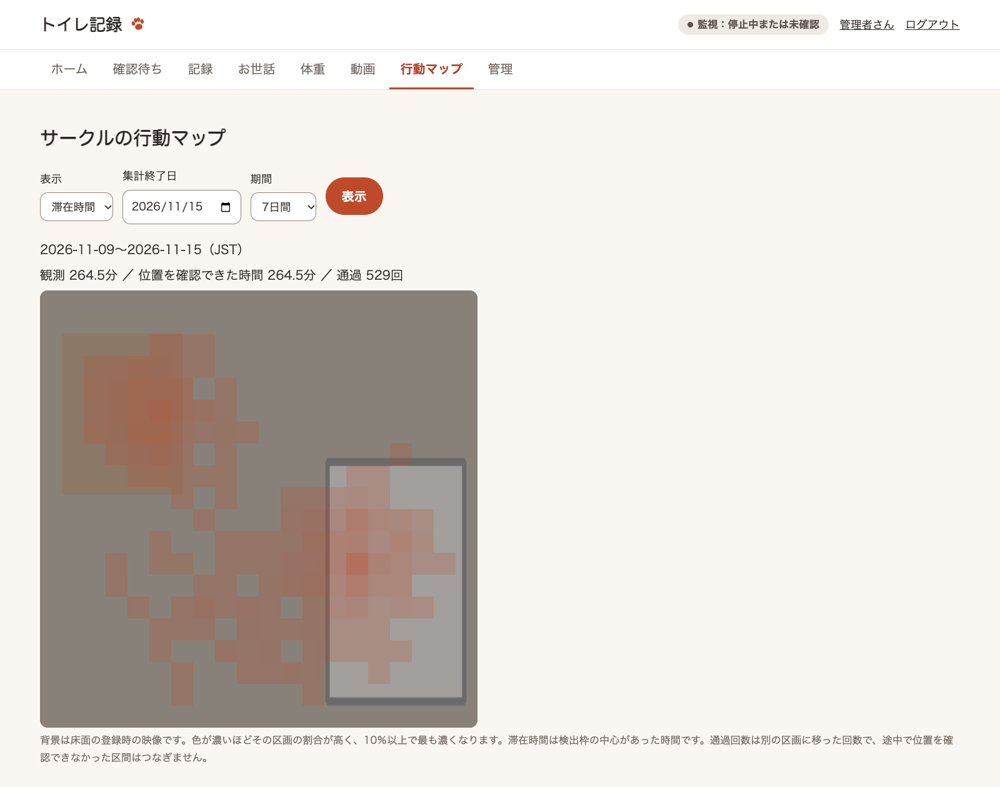

# 犬の検出

## 犬の存在・トイレへの出入りを検出する

OpenCV Zoo の YOLOX モデルを使い、犬の検出枠が ROI に重なる間は排泄の差分判定を保留します。
トイレへの入場・退場も短い動画の保存トリガーにするため、差分通知が出ない日常動作を集められます。
姿勢推定や排泄の認識ではありません。検出枠の重なりは保守的な判定で、犬の体が実際にトイレを隠しているとは限りません。

```bash
uv run poop-detector setup-dog-model
uv run poop-detector run --dog
```

モデルは初回に明示コマンドで取得します。固定版と SHA256 を確認し、`data/models/dog-yolox` に保存します。
監視開始時に自動ダウンロードしません。既存モデルが異なる場合は上書きせず停止します。
毎回 `--dog` を付ける代わりに、`config/config.yaml` の `dog.enabled: true` で有効にできます。

- 既定1秒1回の犬推論、2秒の見失い猶予を使います。`dog.fps` を下げるときは `dog.exit_seconds` を `2 / dog.fps` 以上にします。
- 入場と退場の保存には、それぞれ既定60秒のクールダウンを設定しています。
- 犬の推論エラー時は排泄判定を保留し、再試行します。
- 画像取得と動画バッファは別スレッドで継続します。動画を無効にした場合でも犬による遮蔽判定は使えます。

手元の静止画で検出枠と負荷を確認できます。画像パスは実際のファイルに置き換えてください。

```bash
uv run poop-detector check-dog --image /absolute/path/to/image.jpg --repeat 10
```

結果は `data/models/dog-yolox/check-dog.json` に保存し（画像の場所と検出枠は保存しません）、GUI の「管理 › 判定器とモデル」に、モデルのハッシュの確認結果と並べて出します。

カメラの設置位置を変える前の、犬が写った保存画像で検出を確認し、人工の無地画像では検出なしでした。
開発者の Apple Silicon の Mac で、反復推論は平均約73ms、プロセス RSS 約421MiB でした。CPU の表示値は休止なしの反復推論時の値です。
現在の俯瞰の設置位置での Precision/Recall と、RTSP の処理を含む総負荷は未確認です。カメラを固定し、実動画で見逃しと誤検出を確認してください。
モデルの比較・検証結果は [dog-model-validation.json](dog-model-validation.json) に記録しています。画像やモデル自体はリポジトリに含めません。

出典・モデルライセンス：[OpenCV Zoo YOLOX（Apache 2.0）](https://github.com/opencv/opencv_zoo/tree/48b10fa505aeb51fbd127fc60a5c660040e823b7/models/object_detection_yolox)。
重い追加の Python 依存は導入せず、既存の OpenCV DNN で CPU 実行します。

## トレー外の排泄候補を検知する

> **実験的な機能です。** 判定の方法を試している段階で、精度は確かめていません。今後、変わったり外れたりすることがあります。

既存のトレー範囲を登録した状態で、トレーと監視したい周囲の床を囲みます。
トレー外で犬が約2秒とどまると、その前後の動画を保存します。
動画の自動判定で新しい便、尿の流れ、または新しい濡れ跡を確認した場合に、トレー外の候補として通知します。`--video-review` が必要です。

```bash
uv run poop-detector setup-roi --outside   # GUI の「管理 › 範囲の登録」でも登録できる
uv run poop-detector run --dog --video-review --detect-outside
```

トレー追従や見守り通知を使用中なら、`--track-tray` や `--early-alert` も起動コマンドに付けます。
トレー外での滞在と手動保存の動画では、登録範囲内の画像を選んだ判定器に渡します。
動画ラベルと確定記録には「トレー内」「トレー外」を保存できます。
短時間で犬が通過した場合や、床の濡れが映像に出ない場合は検知できないことがあります。

## サークルの行動マップ

カメラを固定し、監視を停止します。画面に映っている床の外周に沿って、時計回りか反時計回りに3点以上をクリックし、Enter で登録します。凹みのある範囲も指定できます。新規登録の多角形は射影補正を行わず、外側を集計から除外します。以前登録した四角形は従来の座標で利用できます。

```bash
uv run poop-detector setup-activity-map   # GUI の「管理 › 範囲の登録」でも登録できる
uv run poop-detector run --dog --video-review --early-alert --track-tray --activity-map
```

普段の監視オプションに `--activity-map` を追加してください。犬の検出が自動で有効になります。サークル全体の元映像で約1秒間隔の位置推定を行い、画像や動画の代わりに、20×20区画の日別集計を `data/activity.sqlite3` に保存します。背景には登録時の床面画像を1枚使います。


GUI を再起動し、「サークルの行動マップ」で滞在時間・通過回数と1・7・30日間の集計を切り替えられます。位置を確認できなかった区間は通り道としてつなぎません。
トレー配置を比較する場合は、カメラと床面の登録を維持し、移動の前後で集計終了日を切り替えます。カメラの向きが変わった場合は `setup-activity-map --replace` で登録し直し、監視を再起動してください。登録し直した後の画面は新しい座標の集計を表示します。

## 保存動画から旋回候補を確認する

> **実験的な機能です。** 保存済みの動画の分析だけで、監視や通知にはつながっていません。今後、変わったり外れたりすることがあります。

排泄の前兆として、トレー付近の短い軌跡を分析し、狭い範囲を一方向に回る候補を、動画ラベル画面で確認できます。保存済みの動画を分析するだけで、監視中の通知にはつながっていません。

```bash
uv run poop-detector circling-review --limit 5 --track-tray
uv run poop-detector circling-review --clip 動画ID --track-tray
```

現在の画角で撮影した動画を対象に、通常は未分析のものを手動ラベル付きから優先します。監視でトレー追従を使う場合は `--track-tray` を付けてください。候補は通知せず、動画内の時刻と位置を取得できたコマ数を保存します。動画ラベル画面で候補時刻に移動でき、排泄開始を動画内で記録していれば候補が何秒前だったか確認できます。
