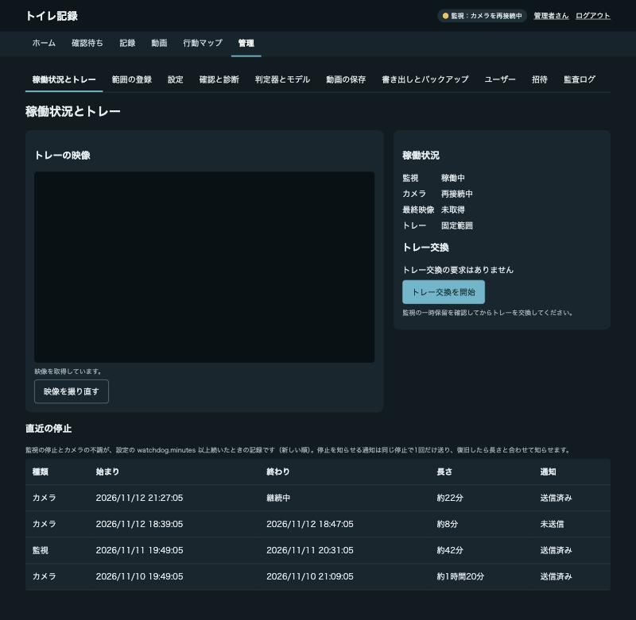

# 通知

通知先は `.env` の設定で決まります。

| 設定 | 通知先 |
|---|---|
| `POOP_NTFY_TOPIC` なし | macOS の通知センター（Linux では通知されません） |
| `POOP_NTFY_TOPIC` あり | ntfy（macOS・Linux とも） |

このほかに、GUI で購読した人の端末へ、ブラウザーの通知（Web Push）でも送ります（下の「ブラウザーで通知を受け取る（Web Push）」）。

どの場合も `config/config.yaml` の `notifications.enabled: true`（既定）が必要です。`pet_name` を設定すると、通知のタイトルと本文に犬の名前が入ります。通知を使わない場合は `notifications.enabled: false` にしてください。

## 通知のテスト

```bash
uv run poop-detector test-notification
```

成功は、OS または ntfy のサーバーが通知を受け付けたことを示します。受信端末で実際に表示されるかを確認してください。macOS では通知の設定や集中モードも確認してください。

## 家族のスマートフォンへ ntfy で通知する

家族のスマートフォンに ntfy アプリを入れ、全員で同じ `ntfy.sh` のトピックを購読します。無料トピックは公開扱いです。`openssl rand -hex 16` などで推測しにくい名前を一度作り、家族内だけで共有してください。

`.env` の `POOP_NTFY_TOPIC` にトピック名を設定し、送信を試します。

```bash
uv run poop-detector test-notification
```

リポジトリのディレクトリで普段の監視コマンドを起動すると、ntfy を通知先に使います。送信するのは短い本文で、映像やカメラの URL は添付しません。`--early-alert` を付けると見守り通知も届きます。

## 自分で運用する ntfy サーバーを使う

`.env` の `POOP_NTFY_SERVER` にサーバーの URL（例: `https://ntfy.example.com`）を設定すると、`ntfy.sh` の代わりにそのサーバーへ送ります。URL に認証情報や `?` 以降は含められません。`http://` も使えますが、通知の本文が暗号化されずに流れるため、信頼できる LAN 内のサーバーに限ってください。

## 見守り通知を別のトピックに分ける

見守り通知（`--early-alert`）を分ける場合は、別のトピック名を作って `.env` の `POOP_NTFY_EARLY_TOPIC` に設定します。見守り通知を受け取りたい人だけが、そのトピックを追加で購読してください。

```bash
uv run poop-detector test-notification --early-alert
```

テストの通知は、GUI の「管理 › 確認と診断」からも送れます（管理者だけ）。

両方のトピックを設定したら、`--early-alert` 付きの監視を再起動します。排便・排尿候補は通常のトピックに、見守り通知だけは別のトピックに届きます。`POOP_NTFY_EARLY_TOPIC` が未設定の場合、見守り通知も通常のトピックに届きます。

## ブラウザーで通知を受け取る（Web Push）

GUI を開いた端末のブラウザーに、通知を直接送れます。ntfy のトピック（名前を知っていれば誰でも読める）を使わず、ログインして購読した端末にだけ届きます。通知を開くと、確認待ちの画面に移ります。

1. GUI を HTTPS の URL（`gui.public_url`、[外から GUI を開く](remote-access.md)）で開きます。同じマシンの `http://localhost` でも試せます。
2. iPhone・iPad は、Safari の共有メニューから「ホーム画面に追加」し、追加したアプリから開きます（iOS 16.4 以降。ホーム画面のアプリでないと通知を受け取れません）。
3. 右上の名前から「自分の設定」を開き、「通知（Web Push）」の「この端末で通知を受け取る」を押して、通知を許可します。
4. 「自分の端末に通知を試す」で、届くか確かめます。

受け取る通知（排便・排尿の候補、見守り通知）は、一人ひとりが「受け取り方を保存」で選べます（その人のすべての端末に効きます）。見守り通知は既定では受け取りません。監視は、ntfy・macOS の通知と同じ文面を Web Push でも送ります。端末側で購読をやめた（プッシュサービスが無効と答えた）購読は、次に送るときに自動で消します。

- 通知の本文は端末のブラウザーの鍵で暗号化して送り（RFC 8291）、送信元は VAPID の鍵で署名します（RFC 8292）。VAPID の鍵は `data/.web-push-vapid.pem` に1つだけ作り、監視と GUI で共有します（本人だけが読める権限）。鍵を消すと、すべての端末で購読し直しが必要です
- 送り先は、Google・Mozilla・Apple・Microsoft のプッシュサービスに限ります（ほかの宛先の購読は登録できません）
- 本文には、ほかの通知と同じく映像やカメラの URL を入れず、開く画面の相対パスだけを入れます

## 監視の停止とカメラの不調を知らせる

監視が止まっていたり、カメラから映像が届かなかったりする間の排泄は記録されません。気付けるように、次の2つを見張ります（`config/config.yaml` の `watchdog.enabled: true`、既定で有効）。

| 見張るもの | 見張り役 | 知らせる条件 |
|---|---|---|
| カメラの不調 | 監視（`run`） | カメラから映像が `watchdog.minutes`（既定5分）届かない。再接続の繰り返しも含む |
| 監視の停止 | GUI のサーバー（`gui`、`run --gui`） | 監視のハートビートが `watchdog.minutes` 途絶えた |

- 通知は、ほかの通知と同じ送り先（ntfy または macOS の通知）と、管理者の端末の Web Push に送ります。Web Push は、管理者が「自分の設定 › 通知」の「監視の停止とカメラの不調の通知を受け取る」（既定で有効）で選びます。一般ユーザーには Web Push で送りません
- 同じ停止で知らせるのは1回だけです。復旧したら、止まっていた長さと合わせてもう一度知らせます。停止の通知を送れなかったとき（ネットワークの不調など）は、5分ごとに送り直します。停止を知らせていなければ、復旧も知らせません
- 本文は「11/12 09:30からカメラの映像が届いていません」のような短い文で、カメラの URL や映像は入れません
- 停止の履歴は、GUI の「管理 › 稼働状況とトレー」の「直近の停止」で確かめられます（`events.sqlite3` の `outages` テーブル）



監視の停止を知らせるには、監視とは別に GUI のサーバーを動かしておいてください（`poop-detector gui`）。`run --gui` の GUI は監視と同じプロセスで動くので、監視ループが固まったときは知らせますが、プロセスごと落ちたときは知らせられません。プロセスの異常終了には、systemd の `Restart=` や launchd の `KeepAlive` などで監視を自動で起動し直す方法も併せて使ってください。

次のときは知らせません。

- Ctrl+C などで監視を自分で終了したとき（終了したことをハートビートのファイルに残します）。`kill -9` や電源断などで終了の印を残せなかったときは、停止として知らせます
- 監視を一度も起動していないデータの保存先で GUI を開いたとき
- トレー交換で監視を保留している間（カメラの不調として数えません）
- 監視を起動し直したとき、前の監視が残したカメラの不調は知らせずに閉じます

見張りを止めるときは `watchdog.enabled: false` にします。

## 動画の自動判定の通知

`--video-review` を付けて起動すると、差分だけの通知を抑え、動画の自動判定（既定の判定器は Codex CLI）が新しい便や尿の根拠を確認した場合にだけ通知します。[動画](video.md#動画の自動判定と通知を使う) を参照してください。
