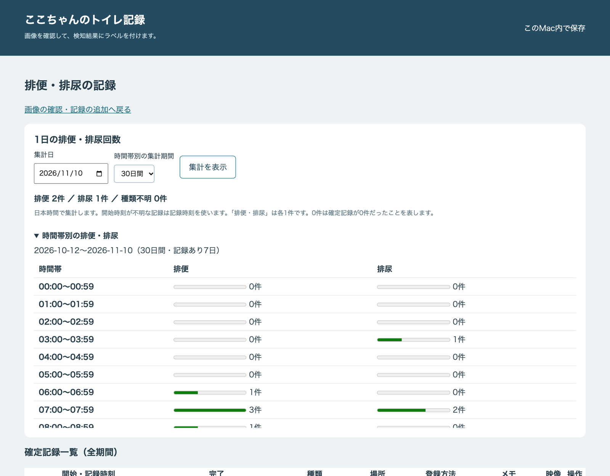

# 記録とラベル付け

通知が実際の排泄だったかを記録し、見逃しを補い、検知の精度を評価するための機能です。動画のラベル付けは [動画](video.md) を参照してください。

## GUI

監視と GUI を同時に起動するには `uv run poop-detector run --gui` を使います。GUI を単独で起動するには、次を実行します。

```bash
uv run poop-detector gui
```

ブラウザに `http://127.0.0.1:8765/?token=...` のようなトークン付きの URL を開きます。GUI を単独で起動する場合は RTSP URL を使わずに記録を閲覧できます。
トークン付きの URL を開くと、そのブラウザーでログインした状態になり、アドレス欄からトークンはすぐに消えます。
ログインした状態は GUI を再起動しても続き、操作がないまま7日か、ログインから30日で切れます（設定の `gui.session_idle_hours`・`gui.session_max_days`）。画面右上の「ログアウト」で、その場で終えられます。
ログインしていないブラウザーやプログラムは、画面・画像・動画を閲覧できません。
終了は起動したターミナルで Ctrl+C です。同時起動では監視と GUI の両方が終了します。ポートを変更する場合は `run --gui --gui-port 8766` または `gui --port 8766` を使います。

ブラウザーを自動で開かない場合は、どちらのコマンドにも `--no-browser` を付け、ターミナルに表示されたトークン付きの URL を開いてください。
別のブラウザーで開き直すときも、この URL を使います。トークンなしの `http://127.0.0.1:8765/` を開くと「アクセスできません」と表示されます。
トークン付きの URL は、出力をファイルに送っているときは表示しません。この URL は起動中だけ有効なパスワードと同じなので、他人に見せないでください。トークン付きの URL を何度も試したり、短い時間に大量の要求を送ったりすると、「要求が多すぎます」と表示されて、しばらく受け付けなくなります。
この GUI は同じマシン内からのみ接続できます。安全対策と限界は [データの保存先と外部への送信](privacy.md#gui-の安全対策と限界) を参照してください。

### パスキーでログインする

家族などの登録した人は、パスキー（端末の指紋・顔・画面ロック）でログインできます。最初の管理者は、監視するマシンで次のコマンドを実行して登録用 URL を出し、その URL を登録する人の端末のブラウザーで開きます。

```bash
uv run poop-detector users invite 家族A --role admin
```

- 登録用 URL は30分以内に一度だけ使えます（`--minutes` で変更）。
- 一般ユーザー（`--role member`）の招待は、管理者と一般ユーザーの権限を分ける機能（[#85](https://github.com/ysakae/poop-detector/issues/85)）が入るまで使えません。それまでは、一般ユーザーも管理者と同じ操作ができてしまうためです。
- 登録したパスキーは、登録したときに開いたドメインでしか使えません。`gui.public_url` を設定していれば外部の URL、していなければ `http://localhost:8765` です。`http://127.0.0.1:8765` で開いたときは、ログインの画面が `localhost` に移ります。
- パスキーをなくしたときは `users recover 名前` で、同じユーザーにパスキーを足す URL を出します。管理者が全員ログインできなくなったときも、このコマンドで戻せます。
- `users list` で登録した人の一覧を、`users disable 名前`・`users enable 名前` で無効・有効を切り替えます。最後の管理者は無効にできません。
- ログインしていない状態で画面を開くと、ログインの画面に移ります。

起動時のトークン付きの URL も、当面は使えます。パスキーへの移行が済んだら廃止します（[#84](https://github.com/ysakae/poop-detector/issues/84)）。

トップ画面に監視中のカメラ映像と直近の動画の自動判定を表示します。
映像は GUI を開いている間に更新され、判定欄には対象クリップと判定の時刻、根拠、手動ラベルが表示されます。
監視と GUI は同じ保存先を使用してください。アップデート後は両方を再起動すると新しい表示が使えます。

## イベント画像へのラベル付け

一覧の画像を確認し、「排便だった」「排尿」「排便・排尿」「種類不明」「誤検知」「保留・未ラベル」を選んで「ラベルを保存」を押してください。
正解・誤検知を保存すると未ラベルの一覧から外れます。「すべて」や「誤検知」へ切り替えて編集できます。
保留は未ラベルのまま残ります。次の画像へは左側の一覧から移動してください。
開始・完了時刻は分かる場合だけ入力します。時刻は画面に表示されたタイムゾーン（[設定](setup.md#犬の名前とタイムゾーン)）で解釈します。入力済みの値も表示され、空にして保存すると消去されます。
「種類不明」は排泄を確認したが便・尿の区別が付かない場合です。判断自体ができなければ保留してください。
画面を開いただけではラベルを変更しません。保存時のみ更新し、自動学習は行いません。

## 目視で確認した排泄の記録

「目視で確認した排便・排尿を記録する」から、種類・開始/完了時刻・メモを手動登録できます。
通常の手動記録と「通知されなかった排泄（見逃し）」を選べます。通常の手動記録は見逃し数には加えません。
通知の画像が既にある場合はそのイベントにラベルを付け、同じ排泄を手動で重複登録しないでください。

## 記録の一覧と集計



画面上の「排便・排尿の記録を見る」で確認済み記録を時系列表示し、編集できます。
記録画面では当日の排便・排尿回数を表示します。日付の区切りは設定したタイムゾーンに従います。集計日を変更すると過去の日付も確認でき、
選んだ日を含む7・30・90日間の記録を1時間ごとに集計できます。開始が不明な場合は記録時刻で集計します。
記録があった日数も表示します。0件は確定記録がなかったことを表すため、実際に排泄がなかった日とは区別してください。
種類別件数は確認済みの通知・手動記録・見逃しを合わせます。「両方」は排便・排尿へ各1件を加算します。

## コマンドラインでの記録

GUI と同じ記録をコマンドでも行えます。時刻はタイムゾーン付きの ISO 8601 で指定し、実際のものに置き換えてください。`EVENT_ID` は `events` の一覧に表示された ID に置き換えてください。

```bash
uv run poop-detector events
uv run poop-detector record --type urine --start '2026-11-08T23:30:00+09:00' --note '目視で確認'
uv run poop-detector records
uv run poop-detector feedback EVENT_ID true --type feces
uv run poop-detector feedback EVENT_ID true --start '2026-11-01T12:00:00+09:00' --end '2026-11-01T12:00:10+09:00'
uv run poop-detector feedback EVENT_ID false
uv run poop-detector acknowledge EVENT_ID
uv run poop-detector missed --type urine --start '2026-11-08T23:40:00+09:00'
```

`--type` は `feces`（排便）、`urine`（排尿）、`both`（両方）、`unspecified`（確認済み・種類不明）です。
CLI の `feedback` で時刻やメモを省略した場合は登録済み値を保持します。GUI では欄を空にして保存すると消去できます。
`feedback` は実際に排泄だったか、`acknowledge` は飼い主が確認したかを記録する別の項目です。

## 評価指標

```bash
uv run poop-detector metrics
```

UTC でイベント時刻・検出開始・通知時刻・処理時間を記録します。誤検知数は UTC 日別です。
Precision はラベル済み通知の TP/(TP+FP)、Recall は TP/(TP+手動登録した見逃し) です。
分母が0なら null を返します。未ラベル数と見逃し数、開始・完了から通知までの秒数リストも出力します。
通知無効・失敗時には通知時刻を記録しません。全件の確認と見逃しの登録がなければ、指標は実際の精度を表しません。
Precision・Recall は排泄の有無についての集計で、便・尿を自動識別する精度ではありません。

## 保存先

保存先の既定値はリポジトリ直下の `data/` です。基準画像、ROI、イベント画像、SQLite を保存します。
画像・ラベルは既存の保存先を使います。種類とメモは追加テーブルに保存し、従来の便の正解ラベルは便として維持します。
