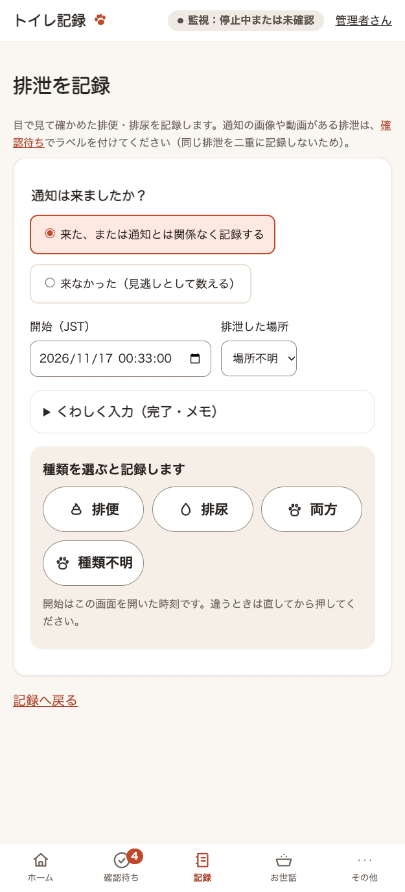
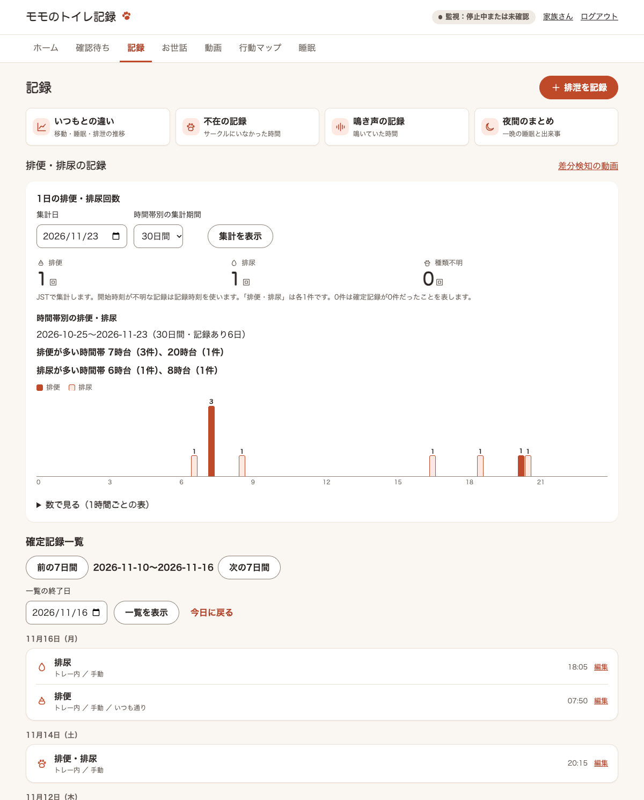
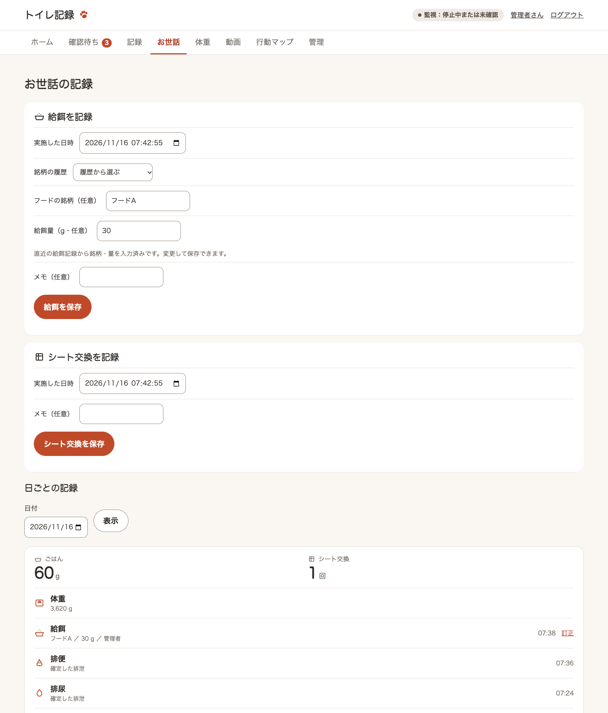
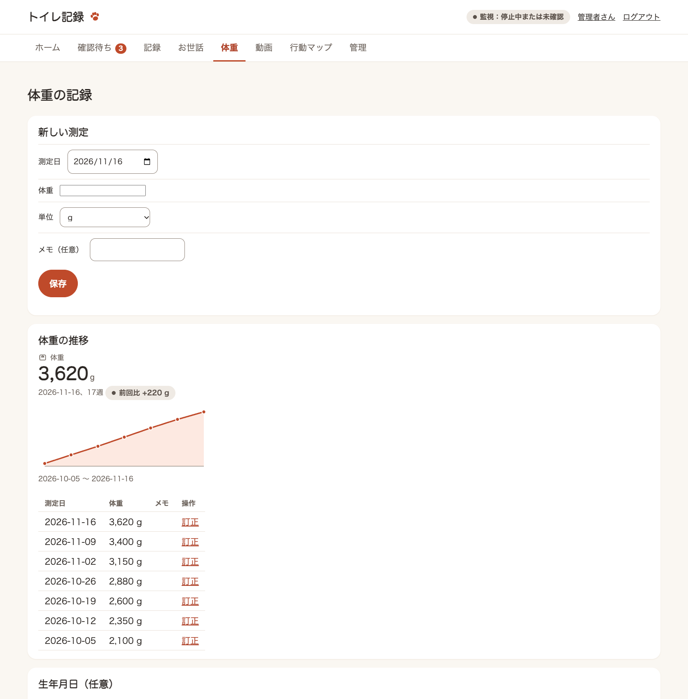

# 記録とラベル付け

通知が実際の排泄だったかを記録し、見逃しを補い、検知の精度を評価するための機能です。動画のラベル付けは [動画](video.md) を参照してください。

## GUI

監視と GUI を同時に起動するには `uv run poop-detector run --gui` を使います。GUI を単独で起動するには、次を実行します。

```bash
uv run poop-detector gui
```

ブラウザーで `http://localhost:8765/` を開きます。GUI を単独で起動する場合は RTSP URL を使わずに記録を閲覧できます。
GUI を使えるのは、パスキーでログインした人だけです（下の「パスキーでログインする」）。ログインしていない状態で開くと、ログインの画面に移ります。
ログインした状態は GUI を再起動しても続き、操作がないまま7日か、ログインから30日で切れます（設定の `gui.session_idle_hours`・`gui.session_max_days`）。画面右上の「ログアウト」で、その場で終えられます。
終了は起動したターミナルで Ctrl+C です。同時起動では監視と GUI の両方が終了します。ポートを変更する場合は `run --gui --gui-port 8766` または `gui --port 8766` を使います。
ブラウザーを自動で開かない場合は、どちらのコマンドにも `--no-browser` を付けてください。
登録用 URL を何度も試したり、短い時間に大量の要求を送ったりすると、「要求が多すぎます」と表示されて、しばらく受け付けなくなります。
この GUI は同じマシン内からのみ接続できます。安全対策と限界は [データの保存先と外部への送信](privacy.md#gui-の安全対策と限界) を参照してください。

### パスキーでログインする

家族などの登録した人は、パスキー（端末の指紋・顔・画面ロック）でログインできます。最初の管理者は、監視するマシンで次のコマンドを実行して登録用 URL を出し、その URL を登録する人の端末のブラウザーで開きます。

```bash
uv run poop-detector users invite 家族A --role admin
```

- 登録用 URL は30分以内に一度だけ使えます（`--minutes` で変更）。
- 最初のユーザーは管理者（`--role admin`）です。2人目からは、メールで招待します（下の「メールで招待・ユーザー管理をする」）。
- 登録したパスキーは、登録したときに開いたドメインでしか使えません。`gui.public_url` を設定していれば外部の URL、していなければ `http://localhost:8765` です。`http://127.0.0.1:8765` で開いたときは、ログインの画面が `localhost` に移ります。
- パスキーをなくしたときは `users recover メールアドレス` で、同じユーザーにパスキーを足す URL を出します。管理者が全員ログインできなくなったときも、このコマンドで戻せます。
- `users set-role メールアドレス --role admin`（または `--role member`）で役割を変えます。最後の有効な管理者は一般ユーザーにできません。
- `users rename メールアドレス --name 新しい名前` で表示名を変えます。名前の規則（1〜40文字・重複不可）は登録のときと同じです。
- `users list` で登録した人の一覧を表示します。`users disable メールアドレス`・`users enable メールアドレス` で無効・有効を切り替えます。メールアドレス未登録の既存ユーザーは名前で指定できます。最後の管理者は無効にできません。
- ログインしていない状態で画面を開くと、ログインの画面に移ります。

画面の上には、監視の状態とメニュー（ホーム・確認待ち・記録・お世話・体重・動画・行動マップ、管理者には「管理」）が出ます。スマートフォンの幅では、メニューの代わりに画面の下にタブ（ホーム・確認待ち・記録・お世話・その他）が出ます。動画・体重・行動マップは「その他」から開きます。画面の一覧と遷移は [画面の構成](screens.md) を参照してください。

右上の自分の名前を押すと、表示名の変更、表示（ライト・ダーク）の選択、ブラウザーへの通知（Web Push）の購読、自分のパスキーの一覧と、別の端末へのパスキーの追加・削除ができます（最後の1つは削除できません）。管理者は「管理」のメニューから、招待メールの送信、ユーザーの管理（ほかの人の表示名の変更を含む）、監査ログの確認ができます。

### 管理者と一般ユーザー

| 操作 | 一般ユーザー | 管理者 |
|---|---|---|
| ホーム・ライブ映像・記録と集計・行動マップ・動画の閲覧 | ○ | ○ |
| 検知と動画へのラベル付け、排泄の記録（手動・見逃し） | ○ | ○ |
| 動画を判定器の比較の評価の候補に入れる・除く、条件のタグ付け | ○ | ○ |
| 「今の前後の動画を保存」、動画の保護の指定 | ○ | ○ |
| 動画の保護の解除、管理 › 動画の保存（録画の整理・削除） | — | ○ |
| 管理 › 稼働状況 | — | ○ |
| 管理 › 範囲の登録（監視範囲と基準画像、床面、トレー外の範囲、トレー交換） | — | ○ |
| 管理 › 設定（設定ファイルの確認と変更） | — | ○ |
| 管理 › 確認と診断（通知のテスト送信、カメラの確認、診断情報） | — | ○ |
| 管理 › 判定器とモデル（判定器・モデルの状態と選び直し、比較の結果、犬検出モデルの状態） | — | ○ |
| 管理 › 招待・ユーザー・監査ログ | — | ○ |

権限のない操作は、画面に入口を出さず、URL を直接開いてもサーバーが断ります（403）。役割の変更は、その人の次の操作から反映されます。

管理者の操作（トレーの交換と登録、設定の変更と復元、通知のテスト送信とカメラの確認、範囲の登録、動画の保護の解除と整理、招待・再送・取り消し、パスキーの復旧、ユーザーの無効化・有効化・役割の変更）は、誰が・いつ・何をしたかを監査ログに残します。「管理」→「監査ログ」で新しい順に200件まで見られます。`users` コマンドでの操作は「監視するマシンのコマンド」として残ります。登録用 URL・確認コード・パスキーなどの認証情報は記録しません。

ホームには、確認待ちの件数、今日の排便・排尿の回数、最近の確定記録、監視中のカメラ映像と直近の動画の自動判定を表示します。
映像は GUI を開いている間に更新され、判定欄には対象クリップと判定の時刻、根拠、手動ラベルが表示されます。
監視と GUI は同じ保存先を使用してください。アップデート後は両方を再起動すると新しい表示が使えます。

### メールで招待・ユーザー管理をする

`config/config.yaml` の `gui.public_url` に公開 HTTPS URL を設定し、GUI を実行するマシンの `.env` に SMTP の接続先と送信元を設定します。[外から GUI を開く](remote-access.md)を参照してください。

```dotenv
POOP_SMTP_HOST=smtp.example.org
POOP_SMTP_PORT=587
POOP_SMTP_FROM=sender@example.org
POOP_SMTP_USERNAME=
POOP_SMTP_PASSWORD=
```

ポート465は接続時から TLS、それ以外は STARTTLS を使います。認証が必要なサーバーではユーザー名とパスワードを両方設定してください。リバースプロキシを使う場合は、登録・確認リンクのクエリ文字列をアクセスログに残さないよう設定してください。

- **招待**　管理者が「アカウント」→「招待メールを送る」で表示名・メールアドレス・役割を指定します。受信者はメールにあるリンクを期限内に開き、パスキーを登録します。初回管理者には上記のローカル CLI も使えます。
- **再送と取り消し**　同じ画面に宛先を入力して操作します。再送では新しいリンクを発行し、以前のリンクを失効させます。送信に失敗した場合も再送できます。
- **既存ユーザー**　「アカウント」で確認メールを送り、ログイン中にメールのリンクを開いてひも付けます。リンク先と既存のパスキーのドメインが異なる場合は、ログイン済みの画面に確認コードを入力します。
- **ユーザー管理**　管理者はメールアドレスでユーザーを検索し、有効・無効と役割の切り替えやパスキー復旧メールの送信ができます。照合時はアドレスの前後の空白を除き、英字の大文字と小文字を同一として扱います。表示名も重複しないように指定してください。

```bash
uv run poop-detector users invite family@example.org --name 家族A --role admin
uv run poop-detector users resend family@example.org
uv run poop-detector users cancel-invite family@example.org
```

## 確認待ちをさばく

メニューの「確認待ち」に、まだラベルのない検知と、排泄に関わる動画が新しい順に並びます（件数はメニューとホームにも出ます）。「確認を始める」を押すと最初の件が開き、ラベルを保存するたびに次の件へ進みます。分からない件は「この件を飛ばす」で後回しにできます。

動画のある検知は、動画で確かめる1件にまとめています。排泄があれば、動画の下の「排便」「排尿」「両方」を押すと検知の記録にひも付けて確定し、排泄がなければ「排泄なし」を押すと検知も誤検知として記録します（時刻やメモを付けるときは「くわしく入力」の「ラベルと確定記録を保存」を使います）。犬の出入りの動画は、自動判定が排便・排尿の候補としたものだけが並びます。並べ方は [画面の構成](screens.md#確認待ち) を参照してください。

## 検知の画像へのラベル付け

検知を探すときは、「動画」の一覧を「差分検知」で絞り込みます（「記録」とホームの「差分検知の動画」から開けます）。まだラベルのない検知は「確認待ち」でさばきます。

検知の画像でラベルを付ける画面は「記録の詳細」（`/records/events?id=…`）です。確定記録の「編集」や、動画のない検知（整理済み・変換の失敗）を確かめるときに開きます。検知の動画があれば「この検知の動画を開く」から移れます。
まだラベルのない検知では、画像の下の「排便」「排尿」「両方」「誤検知」のボタンを1回押すだけで保存できます（動画の画面と同じ操作です）。場所・開始と完了の時刻・メモは、それまでの値を保ちます。
場所・時刻・メモを付けるとき、「種類不明」や「保留・未ラベル」を選ぶとき、ラベル済みの検知を直すときは、「くわしく入力」を開いて選び、「ラベルを保存」を押してください（ラベル済みの検知では最初から開いています）。
確認待ちから開いた検知は、どちらで保存しても次の件へ進みます。
正解・誤検知を保存すると未ラベルの一覧から外れます。「すべて」や「誤検知」へ切り替えて編集できます。
保留は未ラベルのまま残ります。次の画像へは左側の一覧から移動してください。
開始・完了時刻は分かる場合だけ入力します。時刻は画面に表示されたタイムゾーン（[設定](setup.md#犬の名前とタイムゾーン)）で解釈します。入力済みの値も表示され、空にして保存すると消去されます。
「種類不明」は排泄を確認したが便・尿の区別が付かない場合です。判断自体ができなければ保留してください。
画面を開いただけではラベルを変更しません。保存時のみ更新し、自動学習は行いません。

## 目視で確認した排泄の記録

ホームの「排泄」か、「記録」の「排泄を記録」（`/records/new`）から、種類・場所・開始/完了時刻・メモを手動登録できます。開始には画面を開いた時刻が入っているので、見かけてすぐなら種類のボタン（排便・排尿・両方・種類不明）を押すだけで記録できます。保存すると「記録」に戻り、足した記録が一覧に並びます。

カメラの監視範囲外での排泄は、場所に「サークル外」を選びます。サークル外の排便・排尿は、一覧や集計には含まれ、監視の見逃し件数からは除外されます。



監視範囲内の排泄で通知が来なかったときは、「通知は来ましたか？」で「来なかった（監視範囲内の見逃し）」を選びます。

カメラなしの手動記録モードでは、時刻・場所・種類を選んで保存できます。
通知の画像が既にある場合はその検知にラベルを付け、同じ排泄を手動で重複登録しないでください。

## 記録の一覧と集計



メニューの「記録」で確認済みの記録を時系列で表示し、「編集」から直せます。
記録画面では当日の排便・排尿回数を表示します。日付の区切りは設定したタイムゾーンに従います。集計日を変更すると過去の日付も確認でき、
選んだ日を含む7・30・90日間の記録を1時間ごとに集計し、24時間の棒グラフで示します。排便・排尿それぞれで、件数の多い時間帯を最大2つ表示します。数は「数で見る（1時間ごとの表）」を開くと表で読めます。開始が不明な場合は記録時刻で集計します。
記録があった日数も表示します。0件は確定記録がなかったことを表すため、実際に排泄がなかった日とは区別してください。
種類別件数は確認済みの通知・手動記録・見逃しを合わせます。「両方」は排便・排尿へ各1件を加算します。

## 留守中のまとめ

出かけるときにホームで「外出中にする」を押し、帰ったら「在宅に戻す」を押すと、その間のまとめ（`/digest`）ができます。戻ってから24時間は、ホームに「留守中のまとめを見る」が出ます。

- **タイムラプス**：常時録画はしないので、外出中の間だけ1分ごと（`digest.snapshot_seconds`）にカメラの静止画を残し、つなげた動画を見せます。1時間が約5秒です。初めて開いたときに作るので、少し待つことがあります。静止画は `digest/` に置き、7日で消します。バックアップには入れません。
- **出来事**：その間の排泄の記録、トイレの変化の検知、保存した動画、サークルにいなかった時間（不在の記録を使うとき）、床の候補（使うとき）を時刻の順に並べ、寝ていた時間（睡眠の記録を使うとき）を出します。

監視（`run`）が動いていないと静止画は残りません。使わない場合は `digest.enabled: false` にします。

`digest.summary: true` にすると、外出から戻ったあと、GUI のサーバー（`gui` か `run --gui`）が年表の文字を動画の自動判定と同じ判定器（`review.provider`・`review.model`）に渡し、3〜5文の要約と、確かめたほうがよい点を最大5つ作って、まとめの先頭に出します。作れなかったときや作り直したいときは、画面のボタンで頼めます。年表の文字を判定器の提供元に送るので既定は無効で、静止画も添えるのは `digest.summary_images: true` のときだけです（4枚まで）。判定器を呼ぶのは1時間に4回までで、動画の自動判定の上限とは別に数えます。24時間より前に終わった外出は、頼まない限り要約しません。要約は記録を見返すきっかけで、獣医師の判断の代わりにはなりません。

## いつもとの違い

記録の画面の下の「いつもとの違い」（`/trends`）に、直近14日の移動・睡眠の時間・排便と排尿の回数を並べます。その日より前の14日のいつもの値と比べて大きく違う値には「多い」「少ない」の印が付き、昨日に印があればホームにも出ます。

- 移動は、行動マップ（`features.activity_map`）で床面のマス目を通過した回数です。1日の半分以上を観測できた日だけ、1日分に直して出します。
- 睡眠は、睡眠の記録（`sleep.enabled`）で1日の80%以上を観測できた日だけ出します。
- 排便と排尿は、確定記録の回数です（両方の記録はどちらにも数えます）。記録していない日は0回になるので、記録を付けていない時期は比べられません。
- いつもの値のある日が7日に満たないうちは、印を付けません。

同じ指標が2日続けて同じ向きに外れると、GUI のサーバー（`gui` か `run --gui`）が一度だけ通知します。止めるときは `trends.notify: false` にします。印や通知は記録を見返すきっかけで、獣医師の診断の代わりにはなりません。

## お世話と体重の記録

ホームの「最新のお世話」では、ごはん・うんち・おしっこ・シート交換を最後に記録した日時を確認できます。ごはんの量を記録していれば、時刻と一緒に表示します。

メニューの「お世話」（`/care`）で、給餌（フードの銘柄と量）とシート交換を記録します。給餌は、直近の記録の銘柄と量が入力済みで開きます。ホームのボタンからは、前回と同じ給餌とシート交換を1回押して記録できます。

給餌やシート交換を削除するときは、「日ごとの記録」で対象の「訂正」を開き、「記録を削除」から確認します。削除すると日ごとの合計やホームの「最新のお世話」も更新されます。予定に結び付いた給餌は未記録に戻り、記録し直せます。



### ごはんの予定を共有する

「お世話 › ごはんの予定」で毎日の時刻を追加します。予定を開いて記録するか、ホームの時刻付きボタンを使うと、家族の画面でもその予定が「記録済み」になります。予定外のごはんは通常の入力で「予定外のごはん」を選んで記録できます。

知らせがほしい人は、自分の設定の「通知（Web Push）」で端末を登録し、「ごはんが未記録のときに予定を知らせる」を選びます。アプリが動いている間は、予定時刻を過ぎてもその予定に給餌が記録されていない場合に一度だけ知らせます。アプリを閉じていた場合も、時刻から10分以内に起動すれば未記録の予定を確認します。通知サービスが一時的に受け付けなかった場合は、同じ時間内にその端末への送信を試し直します。

### 体重を記録する

「体重」（`/weight`）では、測定日と体重（g か kg）を記録します。最新の体重と前回との差、推移のグラフ、測定の一覧を見られ、生年月日を入れると週齢も出ます。
グラフの縦軸は体重（g）、横軸は測定日です。測定点にポインターを合わせるか、タップまたはキーボードで選ぶと、測定日と体重が表示されます。



## 書き出しとバックアップ

管理者は「管理 › 書き出しとバックアップ」（`/manage/export`）で、期間を選んで確定記録を CSV に書き出したり、動物病院に見せる印刷用の集計（回数と時間帯）を開いたりできます。CSV の列と文字コードは [画面の構成](screens.md#管理--書き出しとバックアップ) を参照してください。

同じ画面か CLI で、データの保存先のバックアップ（ZIP）を作れます。データベースは SQLite のオンラインバックアップで写すので、監視の動作中でも壊れません。

```bash
uv run poop-detector backup poop-detector-backup.zip
uv run poop-detector backup poop-detector-backup-with-clips.zip --clips
```

| 含めるもの | 含めないもの |
|---|---|
| `events.sqlite3`（記録・ラベル・動画の情報・評価の候補とタグ・自動判定・ユーザー・パスキーの公開鍵・監査ログ）、`activity.sqlite3`、監視範囲と基準画像（`roi.json`・`baseline/`・`tray-scenes/`・トレー外の範囲）、行動マップの床面、検知の画像（`events/`）、`--clips` を付けたときの動画（`clips/`） | ログインのセッション、登録用 URL、Web Push の購読（コピーから消し、VACUUM で空き領域からも消す）、Web Push の秘密鍵、`.env`、設定ファイル、ライブ映像、犬検出モデル、比較の結果 |

ユーザーとパスキーを含めるので、復元した後も同じパスキーでログインできます。通知を受け取る端末は購読をやり直してください。動画のサムネイルは入れません（復元した後、一覧を開いたときに動画から作り直します）。家の中の画像を含むので、バックアップのファイルの置き場所に気を付けてください。

復元は、監視と GUI を止めてから、監視するマシンで実行します。目録・ファイルの名前・すべてのファイルの SHA-256 を確かめ、内容を示して確認を求めてから入れ替えます（`--yes` で確認を省けます）。いまのデータは消さず、`data.before-restore-20261112-030405` のように名前を変えて残します。犬検出モデル（`models/`）は元のデータから写します。古い版のバックアップは、復元するときにいまのスキーマへ移します。新しい版で作ったバックアップは断ります。

```bash
uv run poop-detector restore poop-detector-backup.zip
```

## コマンドラインでの記録

GUI と同じ記録をコマンドでも行えます。時刻はタイムゾーン付きの ISO 8601 で指定し、実際のものに置き換えてください。`EVENT_ID` は `events` の一覧に表示された ID に置き換えてください。

```bash
uv run poop-detector events
uv run poop-detector record --type urine --start '2026-11-08T23:30:00+09:00' --note '目視で確認'
uv run poop-detector record --type urine --start '2026-11-08T23:30:00+09:00' --location outside_pen
uv run poop-detector records
uv run poop-detector feedback EVENT_ID true --type feces
uv run poop-detector feedback EVENT_ID true --start '2026-11-01T12:00:00+09:00' --end '2026-11-01T12:00:10+09:00'
uv run poop-detector feedback EVENT_ID false
uv run poop-detector acknowledge EVENT_ID
uv run poop-detector missed --type urine --start '2026-11-08T23:40:00+09:00'
```

`--type` は `feces`（排便）、`urine`（排尿）、`both`（両方）、`unspecified`（確認済み・種類不明）です。
CLI の `feedback` で時刻やメモを省略した場合は登録済み値を保持します。GUI では欄を空にして保存すると消去できます。
`feedback` は実際に排泄だったか、`acknowledge` は飼い主が確認したかを記録する別の項目です。

## 評価指標

```bash
uv run poop-detector metrics
```

UTC でイベント時刻・検出開始・通知時刻・処理時間を記録します。誤検知数は UTC 日別です。
Precision はラベル済み通知の TP/(TP+FP)、Recall は TP/(TP+手動登録した見逃し) です。
分母が0なら null を返します。未ラベル数と見逃し数、開始・完了から通知までの秒数リストも出力します。
通知無効・失敗時には通知時刻を記録しません。全件の確認と見逃しの登録がなければ、指標は実際の精度を表しません。
Precision・Recall は排泄の有無についての集計で、便・尿を自動識別する精度ではありません。

## 保存先

保存先の既定値はリポジトリ直下の `data/` です。基準画像、ROI、イベント画像、SQLite を保存します。
画像・ラベルは既存の保存先を使います。種類とメモは追加テーブルに保存し、従来の便の正解ラベルは便として維持します。
