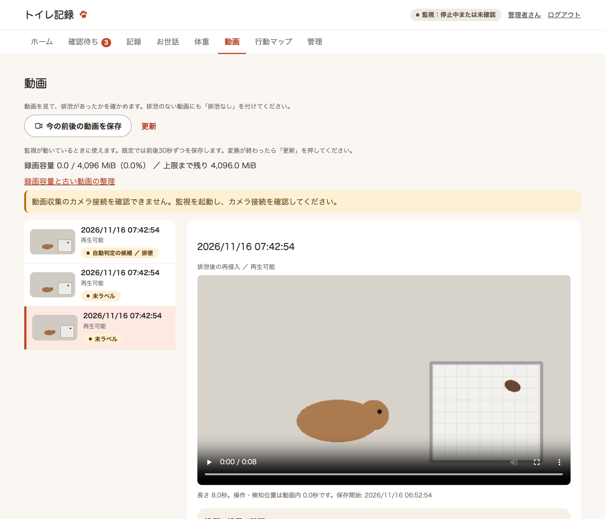

# 排泄後のトレー再侵入を見守る

差分検知で排泄候補を保存した後、犬が生活エリアに完全に出たことを確認します。足元の近似点がトレー内に一定時間入ったら再侵入を記録します。便や尿を区別できるまで、両方を含む差分候補を監視します。

## 領域を登録して起動する

1. `uv run poop-detector check-camera` で接続を確かめます。「管理 › 範囲の登録」のプレビューでトレーと生活エリアを見ます。カメラを動かした場合は、既存の監視 ROI と空の基準画像も再登録します。
2. データディレクトリ（既定は `data/`）に `reentry-layout.json` を作ります。頂点は画像内の周回順に `[x, y]` として並べます。それぞれ画素座標を画像の幅−1・高さ−1で割った 0〜1 の値です。各領域は交差しない3点以上の多角形です。
3. `uv run poop-detector setup-dog-model` で既存の犬検出モデルを用意します。静止画がある場合は `uv run poop-detector check-dog --image FILE` で犬が映った画像の検出枠を確認できます。
4. `config/config.yaml` で `reentry.enabled: true`、`clips.enabled: true`、`features.track_tray: false` を設定し、`uv run poop-detector run --gui` で始めます。再侵入を有効にすると犬検出も有効になります。同じ推論結果を再侵入に使います。

| 配置ファイルの項目 | 内容 |
|---|---|
| `configuration_id` | 配置を識別する新しい文字列。カメラ、トレー、仕切り、領域のいずれかを変更したら新しいIDを使う |
| `installed_at` | 配置の適用時刻。タイムゾーン付きの ISO 8601 |
| `description` | 仕切りの有無、位置、カメラ角度などの短い説明 |
| `toilet_zone` | トレーの見えている床面 |
| `living_zone` | トレーの外で、犬が完全に出たと判断できる床面 |
| `bed_zone` | 任意。配置の記録に使うベッドの位置 |
| `danger_zone` | 任意。排泄物の位置推定を採用する範囲をトレー内の一部に絞る |

| 再侵入設定 | 初期値と意味 |
|---|---|
| `enabled` | `false` |
| `seconds` | `2` 秒。入場・退場の連続確認時間 |
| `margin` | `0.02`。画像の短辺に対する、境界で判定を保留する余白 |
| `high_distance` | `0.04`。画像座標を正規化したときの足元近似点と推定位置の距離 |
| `uncollected_minutes` | `30` 分。未回収のリマインダー。0で無効 |
| `notice` | `medium` は再侵入・HIGH・リマインダー、`high` はHIGH・リマインダー、`off` は新規通知を停止 |
| `quiet_hours` | `""`。抑止するローカル時刻の時を指定。例は `"22,23,0,1,2,3,4,5,6"` |

生活エリアに出たことを確認したらLOW、再侵入でMEDIUM、足元の近似点が局所差分の推定位置に2回連続で近いときはHIGHです。HIGHは通知でも「踏んだ可能性が高い」と表現します。検出枠の下辺中央は推定値であり、画像中の実際の足裏の位置とはずれることがあります。検出枠が画像端で切れる場合や犬が見えない場合は判定を保留し、途切れが長い場合は滞在時間を不明にします。

局所差分を一つに絞れた場合は推定位置を保存します。確定できない場合は「不明」として監視します。片付けの確認は手動で、映像から回収済みに変えることはありません。

推定位置は、次の条件をすべて満たすときだけ更新します。

- 犬が生活エリアにいて、未回収候補が1件だけで、新しい排泄候補が生じていない。
- 空の基準画像との比較が「候補」になっている。
- 局所差分が一つに絞れて、最後の位置から `high_distance` 以内にあり、同じ位置に2回続く。

次の場合は判定を保留し、保存した位置と未回収状態をそのまま保ちます。複数候補の個体識別も保留します。

| 状態 | 基準画像との比較 | 扱い |
|---|---|---|
| 照明の変化（点灯・消灯、赤外線への切り替え） | 不安定 | 位置を保つ |
| 監視範囲の縁にかかる差分（犬の体、影、トレーの縁の遮蔽） | 遮蔽 | 位置を保つ |
| 排泄物が見えない（体の下に隠れた、差分が閾値を下回った） | 空 | 位置を保ち、回収済みにはしない |
| 差分が複数ある、範囲外へ大きく動いた | 候補 | 位置を保つ |

足元の近似点には観測の品質を付けて記録します。検出枠が画面端の `margin` の帯に近い場合（下辺や体が切れている恐れ）と、画像の面積の1%より小さい場合（遠くて下辺中央と足元のずれが大きい）を `low` とします。品質はまだ判定には使わず、HIGH の根拠に数えます。実映像のラベルと比べて、品質で信頼度を下げるかを決めるためのものです。

再侵入とHIGHを検出した時刻に短い動画をリクエストします。カメラ断、動画保存の同時処理上限、容量上限による整理などで動画がない場合があります。動画は既存の `clips` の設定と容量管理を使います。新規通知は通常の通知先を使い、同じ排泄候補・同じ種類の送信を記録します。ntfyやWeb PushがHTTP 429または503を返した場合は、他の送信先で成功・結果不明がなければ1分以上空けて再試行します。初回を含めて最大3回で、片付け済みと判明した候補や通知対象外の時刻には再送しません。既存の排泄候補と動画判定の通知は従来の設定に従います。認証済みGUIを開ける通知先では記録へのリンクを使い、macOSでは本文の記録IDを参照できます。



## 片付けとフィードバック

```bash
uv run poop-detector reentry list
uv run poop-detector reentry collect EVENT_ID
uv run poop-detector reentry event-feedback EVENT_ID --label feces --location tray --stool soft --note '目視確認'
uv run poop-detector reentry visit-feedback VISIT_ID --correct yes --stepped no --note '映像を確認'
uv run poop-detector reentry report
```

- `list` は開始・終了時刻、排泄からの経過秒数、滞在秒数、順番、リスク、位置・足元間の推定距離（HIGHの場合）、イベント画像・動画IDを JSON で表示します。足元を観測した回数（`foot_samples`）、そのうち品質が低い回数（`low_foot_samples`）、HIGH の根拠に品質の低い足元を含んだか（`high_foot_quality`）も表示します。動画IDはGUIの `/clips?id=動画ID` で開けます。差分の `score` は検知スコアです。
- `collect` は実際に片付けた候補ごとに実行します。配置を替えた場合も、前の配置の候補は履歴から片付けを記録できます。再侵入の判定は現在の配置の候補を対象とします。
- 排泄候補の誤りは `--label false`、保留は `--label unknown` で入力できます。便の状態には `normal`、`soft`、`diarrhea`、`other`、`unknown` を使えます。
- 再侵入や踏みつけの判断がつかない場合は `--correct unknown`、`--stepped unknown` を使えます。HIGHと、飼い主が確認した事故件数はそれぞれ集計します。

## 配置ごとの集計の読み方

仕切りを付けた時点で配置ファイルのID・設置時刻・説明・領域を更新し、監視を再起動します。`report` では、確認済みの排便が母数の集計を配置ごとに並べ、各割合の分子と母数を表示します。5・15・30分率は、窓内の再侵入を観測した候補と、窓の終端または回収時刻まで連続観測できた候補で計算します。映像断・画角外・犬の未検出などで結果を確かめられない候補は `unknown` に計上します。監視区間を記録していない旧データも、窓内の再侵入が確認できた場合を除き不明です。

トレー内での排便成功率は、配置の期間内に排便と確認され、トレー内・外が記録された件数を集計します。トレー外での手入力も含みます。母数が空の場合は `null` になり、確認済みの監視対象が20件未満の配置と、分母が20件未満の観測窓には `small_sample` が付きます。割合は記述統計で、仕切りの効果を統計的に判定する処理はありません。

既存SQLiteの関連テーブル（バージョン18）に、連続観測時刻と通知状態をバージョン19・20で、足元の観測品質をバージョン21で追記します。バージョン21より前の訪問は、足元の観測回数を0（不明）として扱います。以前のイベントは再侵入記録を割り当てず、従来の画面から確認できます。画像・映像を含む `data/` と配置ファイルはGitに入れません。バックアップには登録した配置が含まれ、動画はバックアップで動画を含めた場合に保存されます。

## 画角と実映像で確かめること

現位置のまま、昼・夜の歩行映像でトレー全体、生活エリアの境界、犬の足元が映るか確認します。ベッド周りから戻る経路、画面端の歪みや死角、犬の体やトレーのメッシュによる遮蔽も確認します。出入りが見切れる場合は、まず現在の固定位置でトレー全体と生活エリアが画角に入る方向へ調整し、調整後の画角で領域を引き直します。
