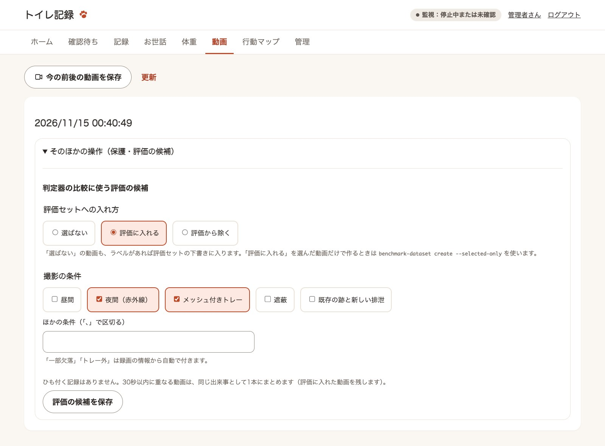
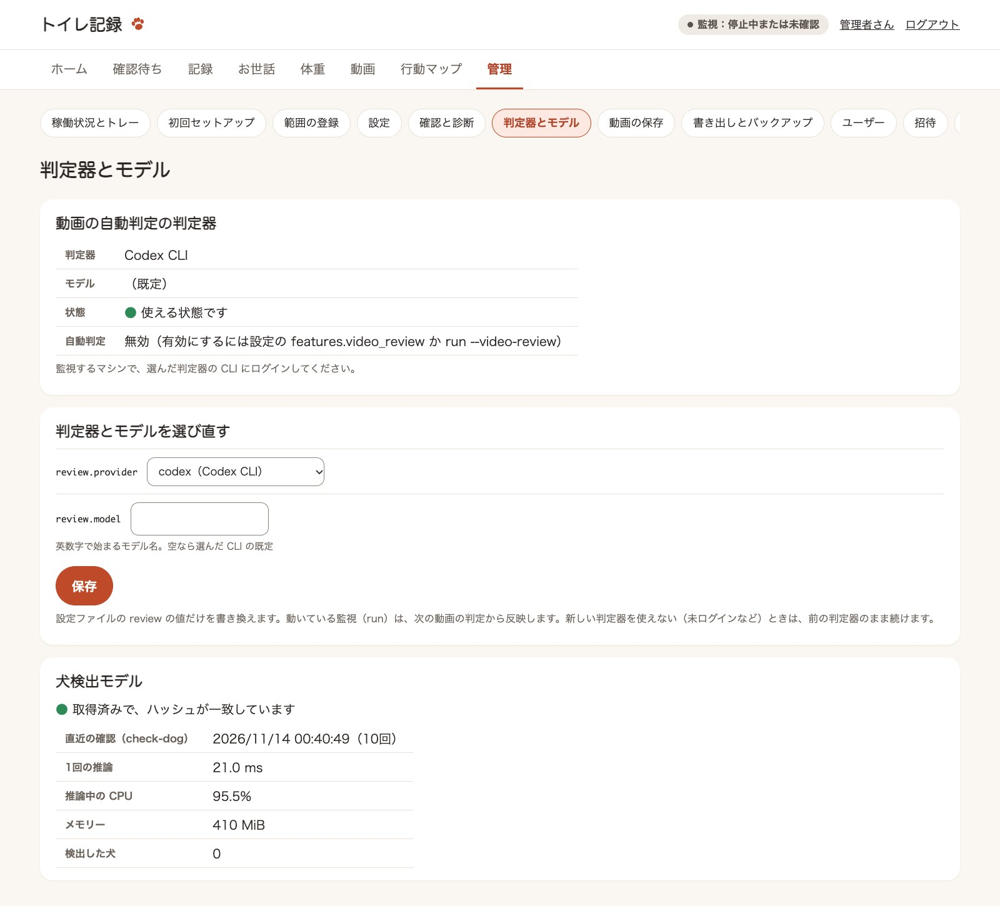
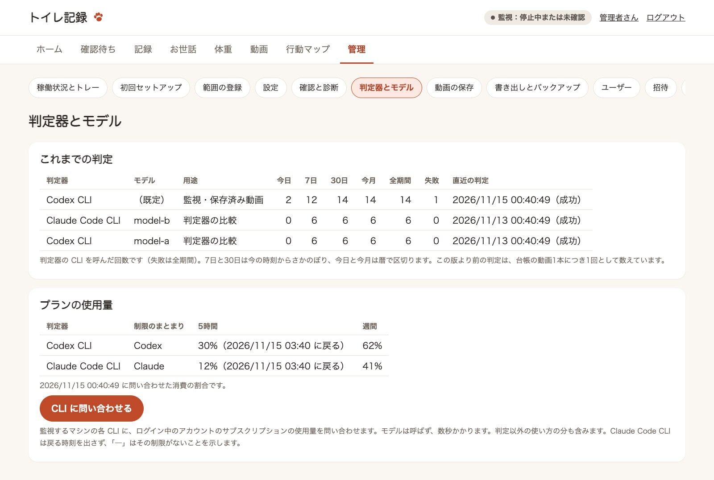
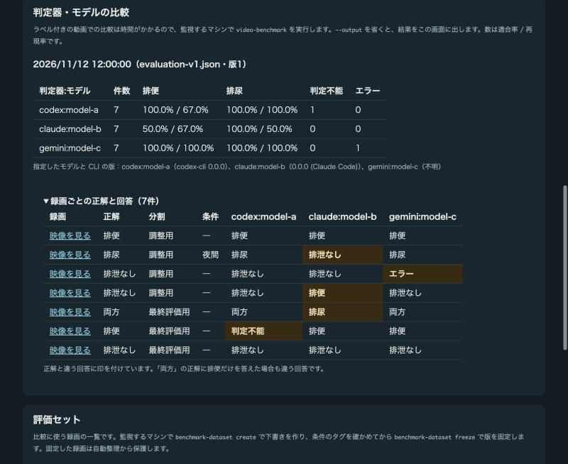
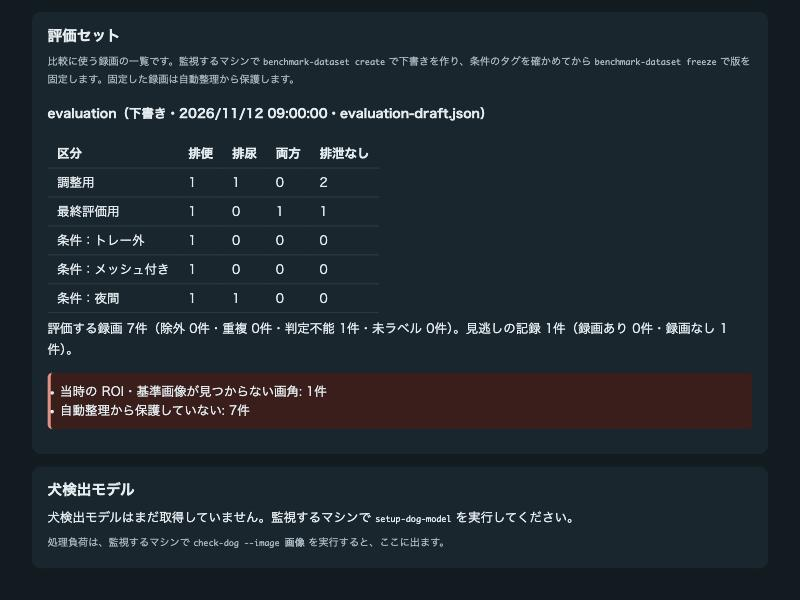
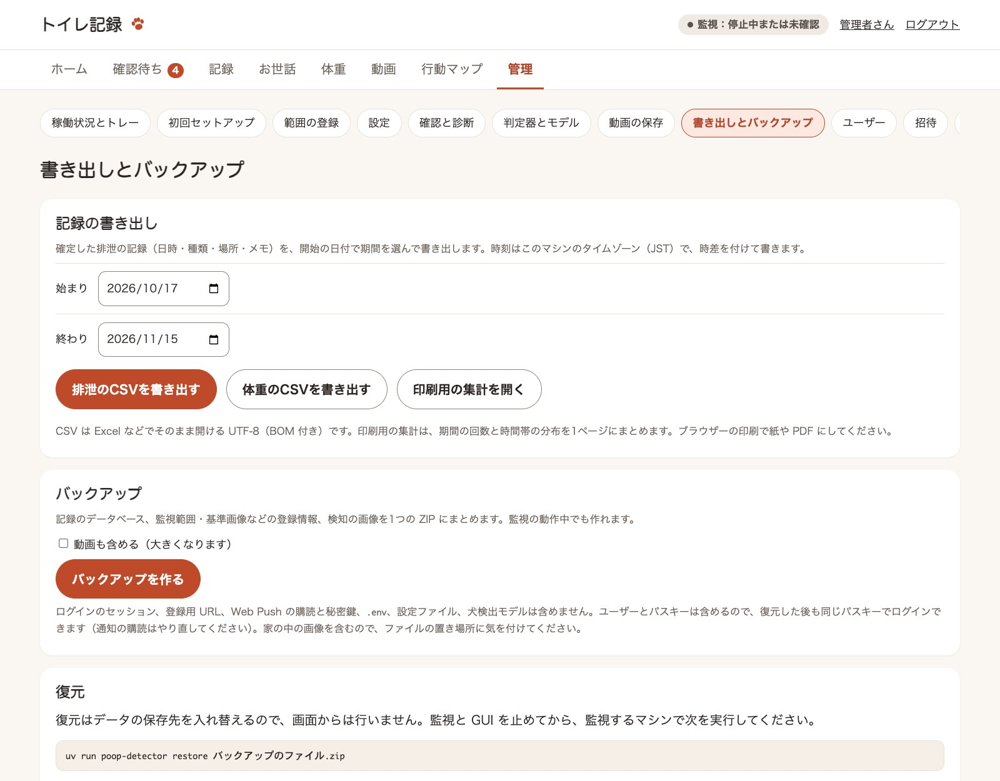
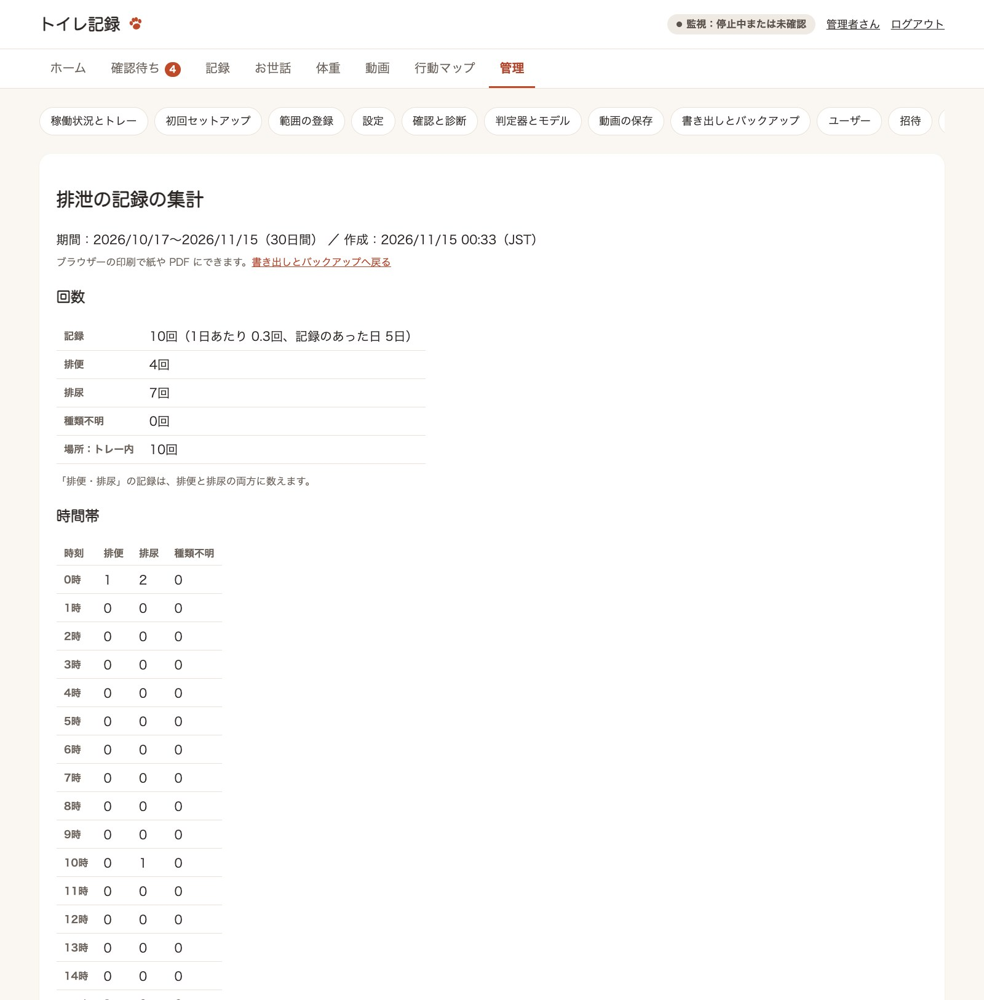

# 画面の構成

GUI の画面の配置と遷移、CLI に残す操作をまとめます（Issue #86）。権限の表は [記録と GUI](records.md#管理者と一般ユーザー)、実装の構成は [設計の概要](architecture.md#gui) を参照してください。

## 共通の枠

ログインしたあとのすべての画面に、同じ枠を出します（`gui/navigation.py`、`templates/base.html`）。

- **見出しの行**　画面の名前、監視の状態（稼働中・カメラを再接続中・停止中または未確認）の色付きのラベル、ログイン中の人の名前（自分の設定へのリンク）、ログアウト
- **メインメニュー**（広い画面）　ホーム・確認待ち（件数付き）・記録・お世話・体重・動画・行動マップ。管理者には「管理」も出す。開いている場所に印を付ける（`aria-current="page"`）
- **下のタブ**（スマートフォンの幅）　画面の下に、ホーム・確認待ち・記録・動画と「その他」をアイコン付きで並べる。「その他」を押すと、お世話・体重・行動マップ・管理（管理者だけ）・自分の設定・ログアウトが開く（`details` 要素で、JavaScript は使わない）。いまの場所が「その他」の中にあれば、「その他」に印を付ける。この幅ではメインメニューと見出しのログアウトを出さない
- **管理のメニュー**　管理の中の画面を開いているときだけ、その画面の上に出す。丸いボタンを横に並べ、入りきらない分は横にスクロールする

ログインの画面とパスキーの登録の画面には、メニューもタブも出しません。メニューは見せ方だけで、管理者だけの画面への要求はサーバーが断ります。メニューとタブに並べる場所は `gui/navigation.py` の1つの表（`MEMBER_SECTIONS`）から作ります。ボタンや入力欄は、指で押しやすい高さ（44px 以上）にしています。

## 画面の一覧

| 場所 | URL | 使う人 | 中身 |
|---|---|---|---|
| ホーム | `/` | 全員 | 確認待ちの件数（塗りのボタンはこれ1つ）、今日の排便・排尿の回数と給餌量、1回押して開く記録の入口（ごはん・シート交換・体重・排泄）、最近の確定記録、ライブ映像と直近の自動判定、録画容量 |
| 体重の記録 | `/weight` | 全員 | g・kgでの測定入力と訂正、生年月日、最新の体重（大きな数字と前回比）と推移のグラフ |
| お世話の記録 | `/care` | 全員 | フードの銘柄・給餌量の入力、シート交換。日ごとに、給餌量の合計とシート交換の回数、その日のお世話・体重・排泄を1本の時系列で見せる |
| 確認待ち | `/review` | 全員 | 未ラベルの検知イベントと、排泄に関わる未ラベルの動画を新しい順に並べる。保存すると次の件を開く |
| 記録 | `/records` | 全員 | 日別の回数（大きな数字）と時間帯別の回数、確定記録の一覧（種類のアイコン付きの時系列） |
| 記録 › 検知の一覧 | `/records/events` | 全員 | 検知イベントの一覧（絞り込み）とラベル付け・修正、目視で確認した排泄の記録の追加 |
| 動画 | `/clips` | 全員 | 一覧・再生・ラベル・確定・保存要求・保護、自動判定と旋回候補、判定器の比較に使う評価の候補と条件のタグ |
| 行動マップ | `/activity` | 全員 | 滞在時間・通過回数のヒートマップ |
| 管理 › 稼働状況とトレー | `/manage` | 管理者 | 監視・カメラ・トレー追従の状態（色付きのラベル。画面を開いたままでも色と文字を更新する）、直近の停止（監視の停止とカメラの不調の履歴）、トレー交換（範囲の描画、基準のプレビュー） |
| 管理 › 初回セットアップ | `/manage/setup` | 管理者 | カメラ接続、トレー登録、監視開始、家族の招待と通知の案内 |
| 管理 › 範囲の登録 | `/manage/areas` | 管理者 | 映像の上に多角形を描き、監視範囲と基準画像（監視が止まっているとき）・トレー外の範囲・サークルの床面を登録する |
| 管理 › 設定 | `/manage/settings` | 管理者 | 設定ファイルの項目の確認と変更（確認してから保存、直前の設定に戻す）、接続情報の有無 |
| 管理 › 確認と診断 | `/manage/checks` | 管理者 | 通知のテスト送信、カメラの確認、診断情報（`diagnose` と同じ内容） |
| 管理 › 判定器とモデル | `/manage/models` | 管理者 | 動画の自動判定の判定器・モデルの状態と選び直し、期間別の判定の回数とプランの使用量、`video-benchmark` の比較の結果、評価セットの件数と欠損、犬検出モデルの状態と `check-dog` の結果 |
| 管理 › 動画の保存 | `/manage/storage` | 管理者 | 録画容量、保持期間、古い動画の整理と削除 |
| 管理 › 書き出しとバックアップ | `/manage/export` | 管理者 | 期間を選んだ確定記録の CSV、印刷用の集計（`/manage/export/summary`）、バックアップの作成、復元の案内 |
| 管理 › ユーザー | `/manage/users` | 管理者 | 検索、役割の変更、無効化・有効化、パスキー復旧メール |
| 管理 › 招待 | `/manage/invite` | 管理者 | 招待メールの送信・再送・取り消し |
| 管理 › 監査ログ | `/manage/audit` | 管理者 | 管理者の操作の記録（新しい順に200件） |
| 自分の設定 | `/account` | 全員 | 表示（ライト・ダーク）、通知（Web Push の購読と受け取り方。監視の異常の通知は管理者だけ）、メールアドレス、パスキーの一覧・追加・削除 |
| ログイン・登録 | `/login`・`/enroll` | ログイン前 | パスキーでのログイン、登録用 URL からのパスキーの登録 |

管理のメニューに並ぶ画面は、すべて管理者だけのルートにします（`tests/test_gui_roles.py` が、メニューとルートの表の役割を突き合わせます）。

## 画面の遷移

```text
/login ──パスキー──> /（ホーム）
/enroll?code=… ──パスキーの登録──> /

ホーム ⇄ 確認待ち ⇄ 記録 ⇄ 動画 ⇄ 行動マップ      （メインメニューでどこからでも）
  │
  確認待ち ─「確認を始める」→ 検知の画像（記録 › 検知の一覧）か動画の画面 ─保存・飛ばす→ 次の件 … → 確認待ち
  │        └─ 記録の「編集」→ 検知の一覧の該当イベント
  │        └─ 「映像を見る」→ 動画の該当クリップ
  └─ 管理（管理者だけ）
       稼働状況とトレー ⇄ 動画の保存 ⇄ ユーザー ⇄ 招待 ⇄ 監査ログ   （管理のメニュー）

名前のリンク → 自分の設定　　ログアウト → /logout → /login
```

保存や操作のあとは、操作した画面に戻します（303）。管理者でない人が管理の画面を開くと、ホームへ戻るリンクを付けた 403 の画面を返します。

## 確認待ち

確認待ち（`/review`）は、ラベルを付ける画面（検知の画像は記録 › 検知の一覧、動画は動画の画面）を順に開いてさばくための列です（`gui/review_queue.py`）。

- 並べるのは、ラベルのない差分の検知と、ラベルのない変換済みの動画のうち排泄に関わるもの（差分検知・手動保存・見守り通知・トレー外の滞在の動画と、犬の出入りの動画のうち自動判定が排便・排尿の候補としたもの）
- 動画のある検知は、動画で確かめる1件にまとめる。検知と動画のどちらかにラベルが付けば終わる。動画で「排泄なし」とすると、ひも付くラベルのない検知を誤検知として記録する（`ClipLabels.save`）
- 動画が変換中・失敗・整理済みのときは、検知の画像で確かめる
- まだ確かめていない変換済みの動画には、動画の下に「排便・排尿・両方・排泄なし」の大きなボタンを出す（`clip_pages.quick_form`）。1回押すと動画のラベルと確定記録を保存し、確認待ちから開いていれば次の件へ進む。自動判定の候補と同じ種類だけを塗りのボタンにする。動作・開始と完了・メモは「くわしく入力」、保護と評価の候補は「そのほかの操作」にたたむ（ラベル済みの動画では「くわしく入力」を開いておく）
- 確認待ちから開いた画面（`from=review`）には、残りの件数と「この件を飛ばす」を出す。保存すると、今の件の次（今の件が列から消えたら、それより古い件）を開く。「保留」で保存しても同じ件には戻らない
- 最後まで進むと確認待ちの画面に戻る。飛ばした件が残っていれば、その旨を出す

## 動画 › 評価の候補

動画の画面の下に、判定器の比較に使う評価の候補を選ぶ欄があります（`gui/templates/_benchmark_candidate.html`、`video/benchmark_candidates.py`）。

- 出すのは、保存済みで、排泄の種類（排便・排尿・両方）か排泄なしのラベルを付けた動画だけ。ラベルのない動画と「判断できない」の動画には、ラベルを保存すると選べる旨だけを出す
- 「選ばない」「評価に入れる」「評価から除く」を選び、撮影の条件のタグ（昼間・夜間（赤外線）・メッシュ付きトレー・遮蔽・既存の跡と新しい排泄）にチェックを付ける。ほかの条件は「、」で区切って書く（1つ30文字・10個まで）。「一部欠落」「トレー外」は `benchmark-dataset create` が録画の情報から自動で付ける
- 動画がひも付く記録（確定記録か検知）を示し、同じ記録の動画や30秒以内に重なる動画は1本にまとめることを伝える
- 選んだ動画は、一覧のラベルの後ろに「評価に入れる」「評価から除く」と出る
- 操作できるのは、ラベル付けと同じく一般ユーザーと管理者。録画を消さず、評価セットの版の固定（録画の保護を伴う）は CLI の `benchmark-dataset freeze` に残すため



## 管理 › 設定

`config.SETTINGS` の表から入力欄を並べます（項目ごとの手書きの画面は作りません）。`gui/settings_routes.py` が画面、`settings_file.py` が保存を受け持ちます。

- 「変更を確認」で、変える項目の今の値と新しい値を並べ、「この内容で保存」で書き換える。検証は CLI と同じ（`Config` と `check_monitor_features`）で、範囲外の値は項目名と範囲を示して断る
- 書き換えるのは変えた項目の値だけで、コメントと並び順は残す（ruamel.yaml）。古い書き方（`clip_enabled`、`features.codex`）で書いてある項目は、その場所の値を書き換える
- 同じディレクトリの一時ファイルに書いてから置き換え、直前のファイルを `config.yaml.previous` に1つ残す。「直前の設定に戻す」はこの2つを入れ替えるので、戻したことも戻せる
- 画面を開いたあとに設定ファイルがほかで書き換えられていたら、保存を断る（409）
- 外からの公開に関わる項目（`gui.host`・`gui.port`・`gui.public_url`・`gui.trusted_proxies`）と `data_dir` は表示だけ。誤ると外から開けなくなる・データの場所が変わるため、監視するマシンで設定ファイルを編集する
- 接続情報（RTSP URL、ntfy のトピックとサーバー）は `.env` に残し、画面には「設定あり・未設定」だけを出す
- 監視と GUI は起動したときに設定を読む。保存した設定は、監視と GUI を起動し直すと反映される。例外は判定器とモデル（`review.provider`・`review.model`）で、動いている監視が次の動画の判定から反映する（管理 › 判定器とモデル）
- 保存と復元は監査ログに残す（項目名と変更前後の値。接続情報は扱わないので入らない）

## 管理 › 確認と診断

CLI の `test-notification`・`check-camera`・`diagnose` と同じ処理を、画面から行います（`gui/checks_routes.py`）。

- 通知のテスト送信：設定ファイルと `.env` で通知を組み立て、トイレの通知か見守り通知のテストを1通送る。送ったことを監査ログに残す
- カメラの確認：監視が止まっているときは、カメラから映像を1枚取得して大きさを示す。監視が動いているときは、カメラに別の接続を開かず（2本目の接続でカメラが不安定になるのを避ける）、監視の接続の状態と最後の映像の時刻を示す
- 診断情報：`diagnose` と同じ YAML を表示する。接続情報の値・保存先のパス・犬の名前は含まない
- 失敗したときは、このパッケージが書いた文言だけを出す（RTSP の URL を含みうる外部の例外の文字列は出さない）

## 管理 › 判定器とモデル

動画の自動判定の判定器と、犬検出モデルの状態をまとめて示します（`gui/models_routes.py`）。時間のかかる比較やモデルの取得は CLI に残し、画面では状態と保存済みの結果を読みます。



- いまの判定器・モデルと、使える状態か（選択した CLI のインストールとログイン）。監視と同じ確認を使い、認証情報は出さない
- 判定器・モデルの選び直し：設定ファイルの `review.provider` と `review.model` だけを書き換える。検証とコメントの保持は管理 › 設定と同じで、画面を開いてからほかで書き換えられていれば保存しない。変更は監査ログに残す。動いている監視は、動画を判定するたびに設定ファイルの更新時刻を確かめ、判定器とモデルが変わっていれば次の動画の判定から新しい判定器を使う。新しい判定器が使えない（未ログインなど）ときは、前の判定器のまま続けてログに警告を出す。判定の台帳には実際に使った判定器を記録する
- これまでの判定：判定器・モデル・用途（監視・保存済み動画／判定器の比較）ごとに、判定器の CLI を呼んだ回数を今日・7日・30日・今月・全期間で示し、失敗の回数と直近の判定の時刻と成否を添える（`judge_runs` から集計）
- プランの使用量：「CLI に問い合わせる」を押すと、Codex CLI・Claude Code CLI・Antigravity CLI に、ログイン中のアカウントのサブスクリプションの5時間と週間の消費割合を問い合わせ、制限のまとまりごとに示す（戻る時刻が分かれば添える）。モデルは呼ばず、結果は保存しない。インストールしていない CLI と、読み取れない CLI は理由を示す
- 判定器・モデルの比較：`video-benchmark` を `--output` なしで実行すると、結果を `data/benchmarks/` に保存し、新しいものから5件を排便・排尿の適合率 / 再現率で示す。評価セットの版、指定したモデルと CLI の版も示す。新しい結果だけ、台帳にある録画ごとに正解と各判定器の回答を並べ、正解と違う回答に印を付ける。形の違うファイルは件数だけを示す
- 評価セット：`benchmark-dataset` で作った `data/benchmarks/datasets/` の評価セットを、新しいものから10件、種類×分割・条件ごとの件数、重複・判定不能・未ラベル、録画のある見逃しとない見逃し、録画や画角の登録情報の欠損で示す
- 犬検出モデル：取得済みか、ハッシュが一致するか（一致しないファイルの名前）。`check-dog` の直近の結果（推論時間、CPU、メモリー）。画像の場所と検出枠は保存しない







## 管理 › 書き出しとバックアップ

記録を手元の SQLite から持ち出し、別のマシンや再インストール後に戻せるようにします（`gui/export_routes.py`、`records/export.py`、`records/backup.py`）。家の中の画像や記録を含むので管理者だけの画面にし、書き出し・集計の表示・バックアップの作成を監査ログに残します。



- 記録の CSV：開始のローカルの日付で期間（既定は今日までの30日間、最長3660日）を選び、確定記録を書き出す。列は `日付,開始,完了,所要（秒）,種類,場所,メモ,記録の由来,ID`。時刻はこのマシンのタイムゾーンの ISO 8601（時差付き）で、開始のない記録は記録した時刻を使う。文字コードは Excel でそのまま開ける BOM 付きの UTF-8、改行は CRLF。`=`・`+`・`-`・`@` などで始まるメモは、表計算ソフトが数式として動かさないよう先頭に `'` を付ける


- 印刷用の集計：同じ期間の回数（排便・排尿・種類不明、場所別）、1日あたりの回数、記録のあった日数、1時間ごと・1日ごとの件数を1ページにまとめる。動物病院に見せるために、ブラウザーの印刷で紙や PDF にする（印刷ではメニューを隠し、ライトの配色にする）。「排便・排尿」の記録は両方に数える
- バックアップ：ZIP を作ってダウンロードする。動画を含めるかを選べる。中身と除くものは [記録とラベル付け](records.md#書き出しとバックアップ) を参照
- 復元：データの保存先を入れ替えるので、画面からは行わず、監視するマシンで `restore` を実行する（このマシンで実行できることを信頼の根拠にする）

## 管理 › 範囲の登録

映像の上に多角形を描いて、監視範囲と基準画像・トレー外の範囲・サークルの床面を登録します（`gui/areas_routes.py`、`static/areas.js`）。ブラウザーで描くので、画面のない監視マシン（Linux・Docker）でも、ほかの端末のブラウザーから登録できます。

- 映像は、監視が動いていればそのライブ映像、止まっていればカメラから取った1枚を使う。画面に見せた映像をサーバーが ID で預かり（`gui/snapshots.py`、メモリーに10分まで・4枚まで）、保存にはその映像をそのまま使う（ID は1回だけ使える）
- 監視範囲と基準画像は、監視が止まっているときだけ登録する。空のトレーの確認を求め、トレー追従が有効なら縁を確かめてから追従の基準画像も保存する（`capture-baseline` と同じ）。監視が動いている間は、新しい基準を確かめてから切り替える「稼働状況とトレー」のトレー交換を使う
- トレー交換で登録した基準を使っている間は、ここでは監視範囲を登録しない（CLI の `setup-roi` と同じ）
- 登録済みのものを置き換えるときは、確認欄のチェックを求める
- 範囲は多角形（`MaskedROI`）で保存し、交差や重複した頂点は断る
- 登録したものは監視を起動し直すと反映される。登録は監査ログに残す

## デザイン

デザインは1つです（Issue #141）。白に近い面と細い線を骨組みにし、あたたかい差し色（コーラル）、大きめの角丸、犬と肉球の絵で親しみを出します。ライトとダークがあり、既定は OS の設定に従います。

- 一人ひとりが「自分の設定 › 表示」で明るさ（OS に合わせる・ライト・ダーク）を選ぶ。選択は `users` テーブルに保存する
- 以前の2つのテーマ（プロフェッショナル・ワンちゃん）はなくした。設定の `gui.theme` は、書いてある設定ファイルを読めるように受け付けるが、使わない。`users` テーブルの `theme` 列も残すが、読まない
- 色・文字・余白・角丸・影は `templates/style.css` の先頭のデザインの変数（CSS のカスタムプロパティ）にまとめ、画面の CSS は変数だけを参照する。色は `light-dark(ライト, ダーク)` で書き、html 要素の `data-appearance` で切り替える
- 画面は `templates/_macros.html` の部品を組み合わせて作る：アイコン（`icon`）、大きな数字（`stat`）、状態のラベル（`chip`）、空の状態（`empty_state`）。ボタンは、いちばん大事な操作だけを塗り（`button`）にし、ほかは枠線（`secondary`）か文字（`ghost`）にする
- `tests/test_themes.py` が、ライトとダークの両方で、文字と背景のコントラストが WCAG 2.2 の AA（本文 4.5:1、大きな文字と部品の境界 3:1）以上か、変数の外で色を直接書いていないかを確かめる
- 状態は色だけで伝えず、文字でも示す（監視の状態、確認待ちの件数など）
- フォントとアイコンは外部から読まない。文字は OS のフォント（見出しは丸ゴシック）。アイコンはこのプロジェクトのために描いた線画で、形を `gui/icons.py` に持ち、インラインの SVG として出す（線の色は文字の色に従う）。肉球の模様と犬の絵は同梱の SVG（`static/paw.svg`・`static/dog.svg`。CSP の `img-src 'self'` のため data: URI は使わない）
- 監視範囲を描く画面の線と塗り（`static/management.js`・`areas.js`）は、カメラの映像の上に重ねるので、明るさに関わらず同じ色にしている

## PWA と Web Push

GUI はホーム画面に追加できる Web アプリ（PWA）です（`gui/push_routes.py`）。

- マニフェスト（`/manifest.webmanifest`）とアイコン、Service Worker（`/sw.js`、`static/sw.js`）を返す。ブラウザーが Cookie なしで読むことがあるので、ログインしていなくても開ける。CSP には `manifest-src 'self'` と `worker-src 'self'` を加えた
- Service Worker は通知を出し、開くとその画面へ移る。オフラインのときは短い案内だけを出し、画面や記録は保存しない
- 「自分の設定 › 通知（Web Push）」（`static/push.js`）で、この端末のブラウザーの購読を登録・解除し、受け取る通知を選ぶ。購読の宛先は既知のプッシュサービスに限る（`web_push.valid_endpoint`）
- 送信は監視が行う（`web_push.WebPushNotifier`。ntfy・macOS の通知と `FanOutNotifier` で並べる）。詳しくは [通知](notifications.md#ブラウザーで通知を受け取るweb-push) を参照

## 古い URL

管理者の画面を `/manage` の下にまとめ、検知の一覧をホームから記録の下へ移したので、古い URL の GET は新しい URL へ 301 で移します（問い合わせ文字列はそのまま渡します）。古い URL への POST は受け付けません（画面を開き直せば新しい URL へ送ります）。

| 古い URL | 新しい URL |
|---|---|
| `/clips/storage` | `/manage/storage` |
| `/clips/cleanup`（POST） | `/manage/storage/cleanup`（POST） |
| `/account/users` | `/manage/users` |
| `/account/invite` | `/manage/invite` |
| `/account/audit` | `/manage/audit` |
| `/?filter=…&id=…`（検知の一覧） | `/records/events?filter=…&id=…` |

## これから足す画面

Issue #86 の配置の案のうち、まだない画面です。足すときは、メインメニューか管理のメニュー（`gui/navigation.py`）に加えます。

| 場所 | 中身 | 進め方 |
|---|---|---|
| 管理 › 稼働状況の拡充 | 判定器の状態、精度の集計（Precision・Recall） | 別の Issue で作る |

## CLI に残す操作と、GUI に移す操作

監視するマシンで実行できること自体を信頼の根拠にする操作と、時間のかかる一括処理は CLI に残します。日常の保守操作は GUI に移します。

| CLI | 扱い | 理由・移す先 |
|---|---|---|
| `users invite`（最初の管理者）・`users recover` | 残す | GUI に入れない状態から戻すための操作。マシンで実行できることを信頼の根拠にする |
| `users` のほかの操作 | 両方 | GUI の管理 › ユーザー・招待と同じ操作。メールを使えないときのために残す |
| `check-camera`・`setup-roi`・`capture-baseline` | 両方 | 管理 › 確認と診断・範囲の登録でも行える。監視中の登録し直しはトレー交換。画面のないマシンでも GUI から登録できる |
| `setup-activity-map`・`setup-roi --outside` | 両方 | 管理 › 範囲の登録でも行える |
| `test-notification` | 両方 | 管理 › 確認と診断のテスト送信と同じ処理。CLI も残す |
| `show-config`・YAML の編集 | 両方 | 管理 › 設定で確認・変更できる。外からの公開に関わる項目と `data_dir` は設定ファイルで変える。接続情報は `.env` に残す |
| `backup` | 両方 | 管理 › 書き出しとバックアップでも作れる。定期的なバックアップを cron などで作るために残す |
| `restore` | 残す | データの保存先を入れ替える操作。監視と GUI を止め、監視するマシンで実行することを信頼の根拠にする |
| `diagnose` | 両方 | 管理 › 確認と診断に同じ内容を出す。GUI が動かないときのために CLI も残す |
| `metrics` | 残す | 精度の集計。管理 › 稼働状況への表示は今後 |
| `video-review`・`circling-review`・`video-benchmark`・`benchmark-dataset` | 残す | 時間のかかる一括処理。判定は動画の画面、比較の結果は管理 › 判定器とモデルで見られる |
| `setup-dog-model`・`check-dog` | 残す | モデルの取得と性能の確認。状態と `check-dog` の直近の結果は管理 › 判定器とモデルに出す |
| `events`・`records`・`record`・`feedback`・`acknowledge`・`missed` | 両方 | GUI の確認待ち・記録・動画と同じ操作。スクリプトから使うために残す |
| `run`・`gui`・`tray-registration` | 残す | 監視と GUI の起動。`tray-registration` は GUI のトレー交換と同じ処理 |
