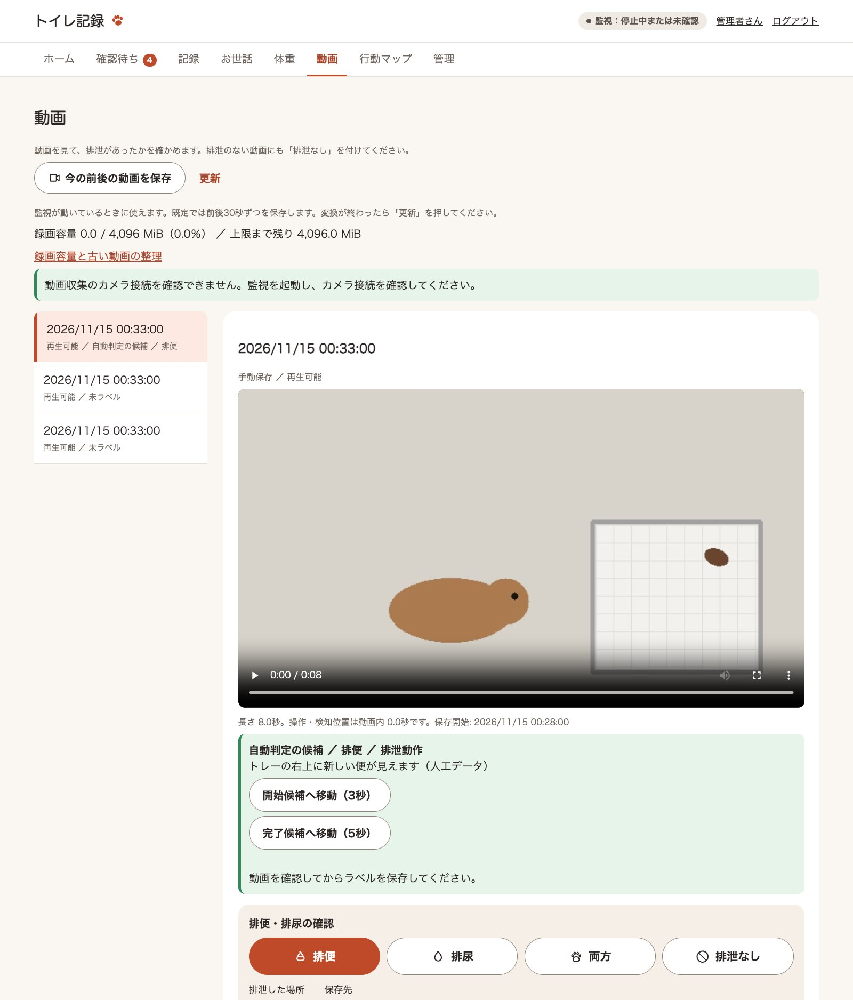

# 動画

## 検知前後の動画の保存

監視を起動すると、検知前後の短い動画を自動保存します（既定は前後30秒、5fps、幅最大1280）。常時録画はしません。
全身の動作を残すため、動画は検知 ROI で切り取らず元映像を縮小して保存します。
FFmpeg の `libx264` が必要です。未導入・容量不足などの失敗は動画一覧に表示します。

```bash
uv run poop-detector run
```

保存のきっかけは、差分による検知のほか、犬の入場・退場（`--dog`）、見守り通知（`--early-alert`）、トレー外での滞在（`--detect-outside`）、GUI からの手動保存です。

設定は `config/config.yaml` の `clips` セクションで変更できます（項目は `config/config.example.yaml` を参照）。`clips.enabled: false` で動画保存を止め、画像検知だけに戻せます。

## 動画の確認とラベル付け



別のターミナルで GUI を起動し、メニューの「動画」を開いてください。

```bash
uv run poop-detector gui
```

- 「今の前後の動画を保存」は監視・カメラ接続中に使えます。食事・座る・匂いを嗅ぐなど、排泄以外の場面も保存してください。
- 操作後30秒の録画と MP4 変換が終わったら「更新」を押し、動画を再生します。
- まだ確かめていない動画には、動画の下に「排便・排尿・両方・排泄なし」の大きなボタンが出ます。1回押すと、動画のラベルと確定記録を保存します。自動判定の候補があれば、その種類のボタンだけが塗りになります。
- 動作タグ、動画内の開始/完了秒、メモ、「判断できない」は、「くわしく入力」を開いて保存します。
- 時刻まで残すときは、「くわしく入力」の「ここを開始にする」「ここを完了にする」で再生位置を取り込み、「ラベルと確定記録を保存」を押します。映っていない時刻は空欄で保存できます。
- 同じ排泄の検知や確定記録があれば保存先で選びます。排便・排尿の記録一覧の「映像を見る」から確認に使った動画を開けます。
- 動画ラベルだけを残す場合は、「くわしく入力」の「動画ラベルのみ保存」を押します。動画の保護と評価の候補は「そのほかの操作」にあります。自動学習はまだ行いません。
- 古いクリップを選んでも、一覧の位置を保ったまま動画とラベル欄が切り替わります。
- 起動直後は過去30秒がないため短い動画になります。切断・停止時も部分動画として明示します。
- 同時保存は4件まで。処理中に上限へ達した要求は受け付けません。
- 保存先は `data/clips`、メタデータ・ラベルは既存 SQLite の追加テーブルです。

## メモリーと容量

メモリー上の圧縮画像ペイロード上限は既定128MiBです（OpenCV や FFmpeg 等の全プロセスメモリー上限ではありません）。
変換時の画像は一時ファイルから渡し、動画全体のペイロードをメモリーへ複製しません。一時ファイル用の空き容量も必要です。
入場から15秒以内に退場し、入場の録画が継続中なら、録画を退場後まで延長して1本にまとめます。
保存済み MP4 が上限（既定4096MiB）に達すると、空きができるまで新しい動画を保存できません。
GUI では使用量と上限までの残りを表示し、使用率が75％・90％に達したときに警告します。
終了時は途中の動画を部分保存してから変換完了を待ちます。動画収集を行う監視は同時に1プロセスだけ起動できます。

## 古い動画の整理

管理者は「管理 › 動画の保存」で、保持期間を選ぶと削除候補と空く容量の目安を確認できます。
既定は7日以上前で、1・3・14・30日にも変更できます。チェックして確定した動画ファイルだけが削除されます。保存済みの動画を自動で削除することはありません。
手動ラベル付き、検知や確定記録にひも付いた動画、自動判定の排泄候補、各動画で「この動画を保護」を押したものは対象から外れます。
整理済みの動画も日時や自動判定の結果は参照できます。

## 動画の自動判定と通知を使う

保存した動画を判定器に見せ、新しい便や尿の根拠を確かめます。既定は Codex CLI です。設定の `review.provider` で `codex`、`claude`、`gemini` を選べます。
[判定器とモデルを選ぶ](#判定器とモデルを選ぶ)を参照し、使う CLI にログインします。
監視に使っているターミナルで監視を停止し、次のコマンドで起動します。動画の保存を有効にしておく必要があります。

```bash
uv run poop-detector run --dog --video-review
```

- 保存済み動画から最大24枚を抜き出し、登録したトイレ領域を切り出した時系列画像を選んだ判定器に渡します。**画像は選んだ提供元の外部サービスに送られます。**
- 録画・変換の完了後、カメラ監視とは別に判定します。通知までに録画後半（既定30秒）、変換、順番待ち、判定器の処理時間がかかります。
- このモードでは差分だけの通知を抑え、新しい便や尿の根拠が見える場合に「動画の自動判定」の候補を通知します。近い時刻の同種の通知は重複を抑えます。
- トレー追従を使うと、網目をぼかして動画の冒頭との明るさの違いを強調した画像を、トレー内の判定で元画像と併用します。
- 食事、通過、判別できない場面では通知しません。録画に一部欠落があっても、排泄の根拠を確認できた場合は「録画に一部欠落があります」と添えて通知します。判定が失敗した場合は動画 GUI に表示します。
- 動画 GUI の自動判定の候補には根拠と時刻が表示されます。内容を確認して保存すると、手動ラベルになります。映像で排泄を確認した場合は「ラベルと確定記録を保存」を使えます。

### 判定器とモデルを選ぶ

`config/config.yaml` の `review.provider` で CLI を選びます。監視を実行するユーザーの環境でコマンドを PATH に追加し、先にログインしてください。

| `provider` | 判定器 | ログイン |
| --- | --- | --- |
| `codex`（既定） | Codex CLI | `codex login` |
| `claude` | [Claude Code CLI](https://code.claude.com/docs/en/cli-reference) | `claude auth login` |
| `gemini` | [Antigravity CLI](https://antigravity.google/docs/cli/acp/)（`agy`、1.5.0 以上） | `agy acp --login` |

```yaml
review:
  provider: claude
  model: ""
```

`model` が空欄なら選んだ CLI の既定を使います。指定する場合は、画像入力に対応する CLI 上のモデル名を使ってください。Antigravity のモデル名は `agy models` で確認できます。以前の Claude / Gemini API 用のモデル名で選択に失敗した場合は、空欄に戻すか CLI 上のモデル名に更新してください。認証は CLI のログインを使うため、`.env` の API キーは不要です。

各 CLI は同じ切り出し画像と判定指示を提供元に送ります。起動前に `uv run poop-detector diagnose` で設定した判定器の状態を確認できます。

GUI の「管理 › 判定器とモデル」（管理者だけ）でも、いまの判定器が使える状態かを確かめ、`provider` と `model` を選び直せます。保存した判定器とモデルは、動いている監視（`run --video-review`）が次の動画の判定から使います。新しい判定器を使えない（未ログインなど）ときは、前の判定器のまま判定を続け、ログに警告を出します。ほかの設定項目は、これまでどおり監視を起動し直すと反映されます。

### 保存済みの動画を判定する

保存済みの未ラベル動画を判定するには、現在のカメラ画角の動画に対して次を実行します。
この操作では通知を送りません。現在の基準画像・ROI で保存した動画を対象とします。成功済みの候補と手動ラベルはスキップし、失敗した候補は再試行できます。

```bash
uv run poop-detector video-review --limit 5
uv run poop-detector gui
```

`video-review --clip 動画ID` で対象を1件に絞れます。動画の ID は GUI で選んだときの URL の `id` です。
